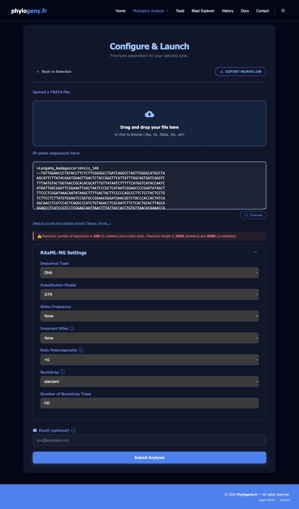
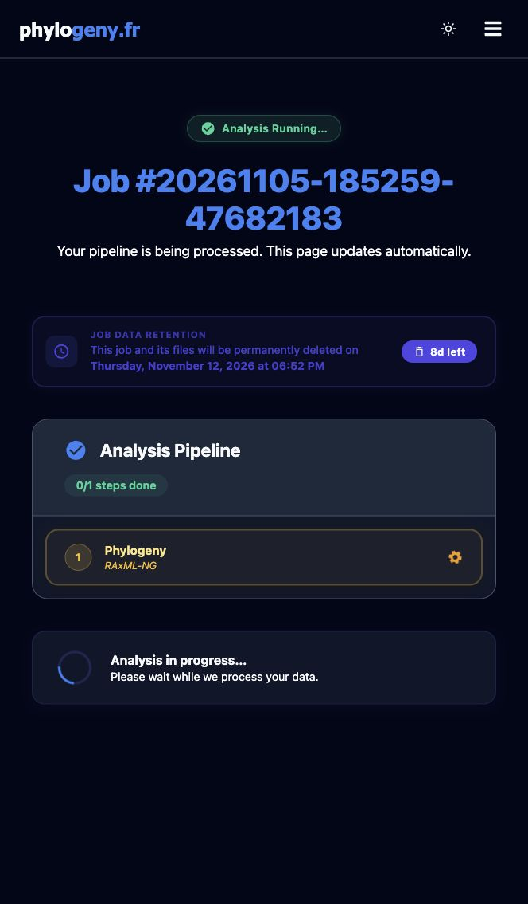
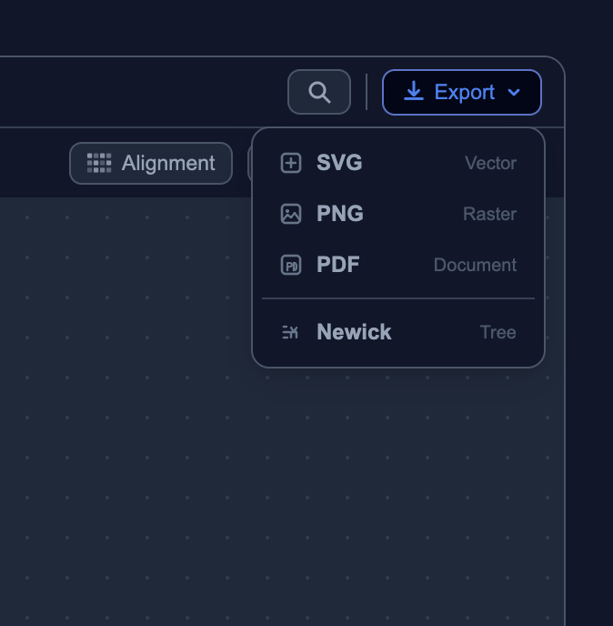

# Estimating Phylogenetic Trees
## *From a DNA barcode alignment to an evolutionary hypothesis*

In the previous modules, we edited sequences, searched for similar sequences, and aligned homologous DNA positions. Now we will use that alignment to estimate a **phylogenetic tree**: a hypothesis about the evolutionary relationships among our samples.

We will use [Phylogeny.fr](https://phylogeny.fr/) to run **RAxML-NG**, a program for maximum likelihood tree inference. Everything in this exercise can be done in a web browser; no software installation or account is required.

### Learning objectives

By the end of this module, you should be able to:

1. Explain what maximum likelihood estimates from a sequence alignment.
2. Submit an aligned FASTA file with appropriate DNA settings.
3. Explain how bootstrap resampling measures support for individual branches.
4. Save a tree, its support values, and the information needed to describe the analysis.

## What data are we using?

Download the original alignment: [pseudoxy.aln.fasta](data/pseudoxy.aln.fasta).

This file contains **200 sequences of Malagasy snakes**, with **671 alignment columns** per sequence. Each row represents a sample; each column represents a position proposed to be homologous across samples. There are multiple individuals for many named species, as well as provisional identifications such as `sp.` and `aff.`. The labels `nan_56` and `nan_109` have no species identification; treat them as unidentified samples.

The alignment contains gaps (`-`) and a few ambiguous nucleotide codes (`N`, `R`, and `Y`). Gaps at the ends of shorter sequences can represent missing coverage. **671 columns does not mean every sample has 671 observed nucleotides.** Keep these characters in place: deleting gaps separately from each row would destroy the alignment.

## Methods for estimating trees: Maximum likelihood

A tree consists of **tips** (sampled sequences), **internal branches** connecting groups of samples, and **nodes** where branches meet. Its branching arrangement is the **topology**. Branch lengths describe inferred evolutionary change.

**Maximum likelihood (ML)** asks: given a model of how DNA sequence evolves, which phylogenetic tree and model parameters make our alignment most likely? The program searches among possible tree relationships and estimates branch lengths and model parameters. With 200 samples, there are far too many possible trees to examine every one, so programs use search strategies to find good solutions. RAxML-NG is a common ML program; see [Kozlov et al. (2019)](https://doi.org/10.1093/bioinformatics/btz305).

The result is a hypothesis, meaning we might re-do the analysis or add more data and obtain a different results. 

### What is a substitution model?

A substitution model describes how DNA bases change through time. We will use **GTR+G** as an explicit teaching example:

| Component | Meaning |
| --- | --- |
| GTR | General Time Reversible: allows different rates for different pairs of nucleotide substitutions and unequal base frequencies. |
| +G | Allows evolutionary rates to vary among sites using a gamma distribution. Some positions can change faster than others. |

We choose this model to make the settings reproducible, rather than claiming it is the best-fitting model for this dataset. Research analyses should evaluate model fit and consider appropriate partitions. For a confirmed protein-coding marker, codon positions might be relevant, but first check the marker, reading frame, and alignment.

## Bootstrapping: How well supported are the branches?

Some relationships in a tree have much more support than others because we have more data that suggests they are correct. **Nonparametric bootstrapping** measures how consistently a branch is recovered when we resample alignment columns.

1. Start with the original alignment of 671 columns.
2. Draw 671 columns at random, **with replacement**. Some columns appear several times; others are left out. Each sampled column includes the bases from all 200 samples, preserving their correspondence.
3. Estimate a tree from this resampled alignment.
4. Repeat to obtain many bootstrap trees, then count how often each split in the original ML tree occurs.

If a node splits into two branches in 87 of 100 bootstrap trees, it receives **87% bootstrap support**. We will request **100 standard bootstrap replicates** for our run, but your own research analyses may require more replicates. 

> *If two branches have support values of 98 and 42, which is more stable? Would either value prove a species identification?*

## Exercise 1: Configure the analysis

These instructions follow the interface checked on **November 5, 2026**. Phylogeny.fr is actively developed, so its appearance may change. Its [documentation](https://phylogeny.fr/docs) describes the available workflows.

### 1. Choose the pipeline

1. Open [Phylogeny.fr — A la Carte](https://phylogeny.fr/analysis/a-la-carte). You can also reach it from the homepage or the **Phylogeny Analysis** menu. On a narrow screen, use the menu with three horizontal lines.
2. Dismiss the optional guided tour if it covers the form.
3. Under **Phylogenetic Tree**, select **RAxML-NG**.
4. Leave **Multiple Alignment** and **Alignment Curation** unselected. The summary should show **Alignment: None**, **Curation: None**, and **Phylogeny: RAxML-NG**.
5. Click **Continue to Configuration**.

Our input is already aligned. We are deliberately keeping those columns. Automatic trimming or realignment would change the data and should be a separate, documented decision.

> **Figure 1.** Select only RAxML-NG when starting with the supplied alignment.

### 2. Provide the aligned sequences

Use **pseudoxy.aln.fasta**, the prepared copy linked above. Click the upload area to choose the file, or open it in a plain text editor and paste its **entire contents** into **Or paste sequences here**. Use one input method. Include every header beginning with `>` and all sequence lines; pasting a filename is not enough.

The example run used the paste option. The form allows up to 200 sequences, so our dataset is at that limit. Check the current limit before adding more samples.

### 3. Set the model and support analysis

Expand **RAxML-NG Settings** if collapsed. Set **Sequence Type** first, then **Substitution Model**; selecting GTR reveals additional controls.

| Setting | Value for this exercise |
| --- | --- |
| Sequence Type | **DNA** |
| Substitution Model | **GTR** |
| State Frequency | **None** (no additional frequency modifier) |
| Invariant Sites | **None** |
| Rate Heterogeneity | **+G** |
| Bootstrap | **standard** |
| Number of Bootstrap Trees | **100** |
| Email | Optional; may be left blank |

With GTR, **State Frequency: None** leaves the model's default frequency treatment in place; it does not force equal base frequencies. The combined model passed to RAxML-NG is `GTR+G`. We are not adding a separate invariant-site component.

Choose **DNA** explicitly, since the initial form may default to **AA** (amino acids). Choose **standard** explicitly too: other support methods are not interchangeable with the standard bootstrap interpretation above.

> **Figure 2.** The prepared alignment and settings used for the example analysis.

### 4. Submit and keep a record

Click **Submit Analysis** once. The results page updates automatically while the analysis runs. Save the URL and job identifier. Runtime depends on server load and the settings; bootstrapping can take longer than a tree search alone.

While waiting, record the input filename, sample count, alignment length, program, model, bootstrap method, and requested replicate count.

> **Figure 3.** The submitted example job while processing. This is a progress screenshot, not a completed tree. The [example job page](https://phylogeny.fr/analysis/a-la-carte/20261105-185259-47682183) is temporary; the server lists November 12, 2026 as its deletion date. Use your own job URL for your analysis.

The example run's log confirmed 200 taxa and 671 sites, with GTR+G expanded internally to `GTR+FO+G4m` (estimated base frequencies and four gamma rate categories). It reported RAxML-NG **2.0.4** and random seed **1793901181**, and retained samples with identical sequences. These checks confirm that the input was accepted; check for successful completion separately.

## Exercise 2: Save and check your results

When the job finishes, check that the page reports success and the RAxML-NG step has completed. A tree drawing alone is not a substitute for checking the output and log.

1. Inspect the tree using the viewer's zoom and display controls. With 200 tips, enlarge sections to read individual labels.
2. In **Generated Files**, use **Download All** to save the archive. Keep the supported tree in **Newick** format and the RAxML-NG log. Newick stores branching structure, branch lengths, and, in a supported tree file, internal support labels.
3. Confirm that the supported tree retains all **200 sample labels**, including numeric identifiers. Identical barcode sequences may have zero or very short branches between them; the data cannot resolve their order.
4. Read the log to confirm input dimensions, model, bootstrap method, completed replicate count, and warnings. Record the version from the log; it may differ from the website's references panel. Save the random seed if reported.
5. Save an image for discussion as well as the Newick file and log. The server displays a deletion date for each job: download the files before that date.

## Export the tree as Newick

For downstream plotting you can export the tree using the text-based 'newick' format.

### First checks before interpretation

**Branch lengths are not bootstrap values.** In an ML phylogram, branch lengths represent estimated substitutions per site; support labels describe stability to resampling. A long branch does not automatically have strong support and does not directly measure elapsed time.

**Root placement needs justification.** A DNA ML analysis under GTR estimates an unrooted tree. A viewer may draw it with a root or apply midpoint rooting, but that does not establish ancestral direction. No outgroup is designated here. Do not assume the first sequence, *Langaha madagascariensis*, is an outgroup because it appears first in the file. Discuss an appropriate outgroup with your instructor before making rooted claims.

**A barcode tree is a gene-tree hypothesis.** It does not automatically represent the species tree. For mitochondrial barcodes, maternal inheritance, introgression, incomplete lineage sorting, and identification errors can complicate the relationship between a barcode genealogy and species boundaries. A strongly supported cluster alone does not establish a new species.

## Questions for discussion

1. Find two samples with the same species name. Are they grouped together? Record their complete labels and support for the relevant branch. Record other samples in the group too.
2. Find a strongly supported branch and a weakly supported branch. What can you conclude about each, and what remains uncertain?
3. Locate `nan_56` and `nan_109`. Which named samples occur nearby? What additional evidence would you want before assigning a species name?
4. Locate a sample labelled `sp.` or `aff.`. What next steps could check its identity? Consider morphology, locality, chromatogram quality, and additional markers.
5. Why might two individuals have identical barcodes? Why is their order difficult to interpret?
6. If you repeated the analysis with 1,000 bootstrap replicates, would you have collected more biological data? Explain what changes.

### Record your analysis

Complete this methods statement using your own results:

> We analyzed 200 snake barcode sequences in an alignment of 671 columns using RAxML-NG [version from log] through Phylogeny.fr on [date]. Whitespace in sequence headers was replaced by underscores; nucleotide sequences and alignment gaps were unchanged. No additional alignment or trimming was performed. We specified GTR+G and assessed branch support using [completed count] standard nonparametric bootstrap replicates. The tree was displayed [unrooted, or describe and justify rooting]. Job identifier: [your job identifier].

## Troubleshooting

| Problem | What to check |
| --- | --- |
| Duplicate sequence names | Use `pseudoxy.aln.fasta`. Spaces cause RAxML-NG to truncate names in this workflow. Keep unique sample identifiers. |
| Input rejected or alignment error | Use the aligned file, not `pseudoxy.fasta`. Confirm every row has 671 columns including gaps, and all FASTA headers and rows were copied. |
| No GTR option | Set Sequence Type to DNA first. |
| No bootstrap values | Check standard bootstrapping was enabled and use the supported tree rather than a tree containing only topology and branch lengths. |
| Overlapping labels | Zoom into a smaller part of the tree, adjust the display, or open the downloaded Newick file in a tree viewer. |
| Job fails | Download its log and read the error before submitting again. Save the job identifier. |
| Low support or unexpected grouping | Review quality, alignment, sampling, and model assumptions. Low support is a result to report, not a reason to keep changing settings until a preferred tree appears. |

## References

* Dereeper, A. et al. (2008). Phylogeny.fr: robust phylogenetic analysis for the non-specialist. [Nucleic Acids Research 36: W465–W469](https://doi.org/10.1093/nar/gkn180).
* Kozlov, A. M., Darriba, D., Flouri, T., Morel, B., and Stamatakis, A. (2019). RAxML-NG: a fast, scalable and user-friendly tool for maximum likelihood phylogenetic inference. [Bioinformatics 35: 4453–4455](https://doi.org/10.1093/bioinformatics/btz305).
* Felsenstein, J. (1985). Confidence limits on phylogenies: an approach using the bootstrap. [Evolution 39: 783–791](https://doi.org/10.1111/j.1558-5646.1985.tb00420.x).
* [Phylogeny.fr documentation](https://phylogeny.fr/docs) and [RAxML-NG documentation](https://codeberg.org/amkozlov/raxml-ng/wiki). For research use, retain citations supplied with your actual run and acknowledge the platform's maintainers as requested on its homepage.

### Continue the workshop

* Previous: [Sequence alignment](Module3-sequence-alignment.md)
* Next: [Interpreting phylogenetic trees](Module5-interpreting-phylogenetic-trees.md)
* [Madagascar 2026 workshop home](index.md)
* [Field2Phylogeny home](https://fieldtophylogeny.github.io/)
