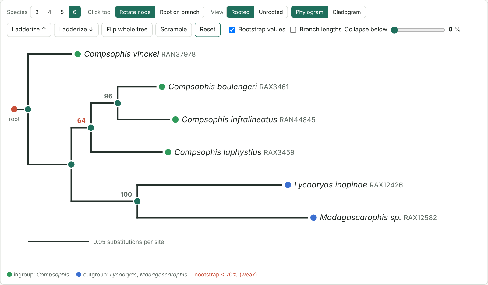
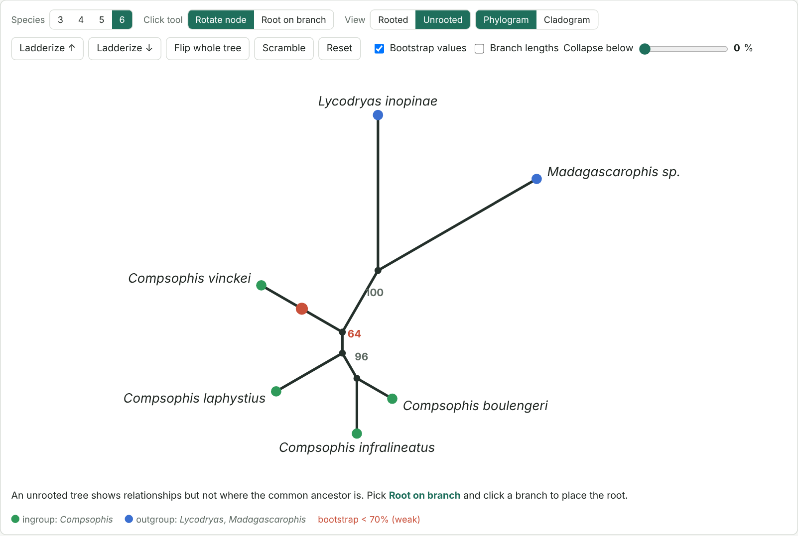

# Viewing and Interpreting Phylogenetic Trees

## *From a Newick file to a figure for a paper, and a map of where your samples came from*

In Module 4 you estimated a maximum likelihood tree with bootstrap support. A tree file on its own is just a line of brackets and numbers. In this module you will learn to **read** a tree: what the branches, nodes, root and bootstrap values mean. Then you will **draw** your tree in R for a scientific paper and link every sample to the place it was collected on a map of Madagascar.

### Learning objectives

By the end of this module you should be able to:

1. Name the parts of a tree: tip, node, branch, clade, sister group, root, outgroup.
2. Explain why rotating a node does not change the tree, and why rooting does.
3. Root a tree with an outgroup.
4. Interpret bootstrap values and decide which relationships are well supported.
5. Read the Newick format.
6. Plot a rooted, bootstrapped tree in R with **ggtree** and save it as a figure.
7. Link each sample on the tree to its locality on a map with dashed lines.

## What data are we using?

| File | What it is |
|---|---|
| [TreeLab](TreeLab.html) | An interactive tree with 3–6 species, for Part 1 |
| Your tree from Module 4 (e.g. `GroupA_COI.raxml.support`) | Your best ML tree with bootstrap values |
| `sample_coordinates.csv` (on your flash drive) | Latitude and longitude of each sample |
| [tree_and_map.R](scripts/tree_and_map.R) | The R script for Parts 3 and 4 |

## Part 1: Reading a tree

### The parts of a tree

| Term | Meaning |
|---|---|
| **Tip** (leaf, terminal) | A sample or species at the end of a branch |
| **Node** | A branching point: a common ancestor |
| **Branch** | The line connecting two nodes, or a node and a tip |
| **Clade** | An ancestor and **all** of its descendants |
| **Sister groups** | Two clades that share a common ancestor not shared with anything else |
| **Root** | The common ancestor of everything in the tree. It sets the direction of time. |
| **Outgroup** | A species we know is outside the group we study (the **ingroup**). It is used to place the root. |
| **Polytomy** | A node with more than two branches: the relationships there are unresolved |
| **Branch length** | The amount of change (substitutions per site) along a branch |
| **Scale bar** | Shows how long a branch of, for example, 0.05 substitutions per site is |

### Exercise 1: Rotating nodes

1. Open [TreeLab](TreeLab.html). It starts with six species.
2. Make sure **Rotate node** is selected. Click any **node** (green circle).
3. Click **Scramble** a few times. Then try **Ladderize ↑**, **Ladderize ↓** and **Flip whole tree**.



*Figure 1: TreeLab. The tree starts rooted in the wrong place on purpose.*

Questions as you go:

* Which species is the **sister** of *Compsophis boulengeri*? Does the answer change when you rotate nodes?
* Look at the **Newick text** under the tree as you rotate. What changes, and what stays the same?

> **Key idea:** a tree is like a mobile hanging from the ceiling. You can spin any branch around its node, and the picture changes, but **who is connected to whom does not**. Never read relationships from the order of names from top to bottom.

### Exercise 2: Rooting

1. Click **Unrooted**. This is how maximum likelihood programs like RAxML actually estimate the tree: they do not know where the root is.
2. The red dot shows where the root is now. Is it in a sensible place?
3. Click **Root on branch**, then click the branch between the two outgroups (*Lycodryas* + *Madagascarophis*) and the rest of the tree.
4. Switch back to **Rooted**. Is *Compsophis* now one clade?
5. Try rooting on another branch, for example on *Compsophis vinckei*. What happens to the relationships among the other species?



*Figure 2: The same tree, unrooted. The red dot marks the root.*

> **Rooting changes the tree.** Moving the root changes which groups are clades and which species are sisters. Always root with an outgroup chosen **before** looking at the result.

### Exercise 3: Bootstrap support

1. Make sure **Bootstrap values** is ticked.
2. A bootstrap value is the percentage of bootstrap replicate trees (re-sampled datasets) that contain that clade. High values (≥ 70%, and especially ≥ 95%) mean the data consistently support the clade. Low values (shown in red) mean the data are uncertain.
3. Move the **Collapse below** slider to 70%. What happens to the weakly supported branch?
4. Click **Cladogram**. What information is lost compared with the **Phylogram**?
5. Try 3, 4 and 5 species. How many different ways can you draw the same 4-species tree?

> A bootstrap value tells you how consistently the data support a clade, **not** the probability that the clade is true. With few variable sites, even a real relationship can have low support.

### Newick format

The text under the tree in TreeLab is the **Newick** format. Every tree program reads it.

```
((Cb:0.031,Ci:0.042)96:0.022,Cl:0.058);
```

* Parentheses `( )` group sister taxa.
* `:0.031` is a branch length.
* `96` after a closing parenthesis is the bootstrap value of that clade.
* `;` ends the tree.

## Part 2: Your RAxML results

RAxML-NG (in Phylogeny.fr, or on the command line) produces several files:

| File ending | What it contains | Use it for |
|---|---|---|
| `.raxml.bestTree` | The best maximum likelihood tree, no support values | |
| `.raxml.bootstraps` | All bootstrap replicate trees (one per line) | Not for plotting |
| `.raxml.support` | **The best tree with bootstrap values on the nodes** | **This module** |
| `.raxml.log` | Settings, model and likelihood scores | The methods section of your paper |

Open your `.support` file in a text editor. It is a single line of Newick. You can also drag it into a tree viewer such as [FigTree](https://github.com/rambaut/figtree/releases) or PearTree for a quick look before you work in R.

## Part 3: A tree for a paper in R

Open RStudio and open [tree_and_map.R](scripts/tree_and_map.R). Run the script one section at a time (select the lines and press **Ctrl+Enter**; on a Mac, **Cmd+Enter**).

### 1. Load the packages

```r
library(ape)
library(ggtree)
library(ggplot2)
library(phytools)
library(maps)
```

> The packages should already be installed on the workshop computers. If not, see section 0 of the script. **ggtree** is installed through Bioconductor and is a large download.

### 2. Read and root the tree

```r
tree <- read.tree("GroupA_COI.raxml.support")
tree$tip.label

outgroup <- c("Madagascarophis_sp2_RAX12582")
tree <- root(tree, outgroup = outgroup, resolve.root = TRUE, edgelabel = TRUE)
tree <- ladderize(tree, right = FALSE)
```

Change the outgroup to the exact tip name(s) of **your** outgroup. `edgelabel = TRUE` keeps each bootstrap value attached to the right branch when the root moves.

### 3. Plot with ggtree

```r
tipdata <- data.frame(label = tree$tip.label,
                      genus = sub("_.*", "", tree$tip.label))
p <- ggtree(tree, linewidth = 0.4) %<+% tipdata
p$data$support <- suppressWarnings(as.numeric(p$data$label))

p <- p +
  geom_tiplab(aes(colour = genus), fontface = "italic", size = 2.6, offset = 0.002) +
  geom_text2(aes(subset = !isTip & !is.na(support) & support >= 70, label = support),
             hjust = 1.3, vjust = -0.5, size = 2.2) +
  geom_point2(aes(subset = !isTip & !is.na(support) & support >= 95),
              size = 1.4, colour = "black") +
  geom_treescale(x = 0, y = -1.5, width = 0.05, fontsize = 2.5) +
  hexpand(0.35) +
  theme_tree()
p
```

What each line does:

| Code | What it does |
|---|---|
| `%<+% tipdata` | Attaches extra information (here, the genus) to each tip |
| `geom_tiplab(... fontface = "italic")` | Species names in italics, coloured by genus |
| `geom_text2(... support >= 70)` | Shows bootstrap values only where they are at least 70 |
| `geom_point2(... support >= 95)` | A black dot on very strongly supported nodes |
| `geom_treescale()` | Scale bar (substitutions per site) |
| `hexpand(0.35)` | Leaves space on the right so long names are not cut off |

### 4. Save the figure

```r
ggsave("Figure_tree.pdf", p, width = 7, height = 10)
ggsave("Figure_tree.png", p, width = 7, height = 10, dpi = 300)
```

Save as **PDF** for a paper: it stays sharp at any size. Use the PNG for slides.

## Part 4: Linking the tree to a map of Madagascar

### 1. The coordinates file

Your `sample_coordinates.csv` has one row per sample:

```
sample,lat,long
Genus_species_ID1,-18.9137,47.5361
Genus_species_ID2,-23.3500,43.6667
```

(These two rows only show the format; use the coordinates in your file.)

* `sample` must match the tip label in the tree **exactly** (same spelling, same underscores).
* Coordinates are in **decimal degrees**. Latitudes in Madagascar are **negative** (south of the equator); longitudes are positive (east).

A blank template is here: [sample_coordinates_TEMPLATE.csv](data/sample_coordinates_TEMPLATE.csv).

### 2. Check that the names match

```r
coords <- read.csv("sample_coordinates.csv")
setdiff(tree$tip.label, coords$sample)   # tips with no coordinates
setdiff(coords$sample, tree$tip.label)   # coordinates with no tip
```

Both lines should print `character(0)`. If they do not, fix the names in the CSV.

### 3. A quick map of the localities

```r
mdg <- map_data("world", region = "Madagascar")
coords$genus <- sub("_.*", "", coords$sample)
ggplot() +
  geom_polygon(data = mdg, aes(long, lat, group = group), fill = "grey92", colour = "grey40") +
  geom_point(data = coords, aes(long, lat, colour = genus), size = 2) +
  coord_quickmap(xlim = c(43, 51), ylim = c(-26, -11.5)) +
  theme_minimal()
```

### 4. Tree and map together

The function `phylo.to.map()` from the **phytools** package draws the tree next to the map and connects each tip to its locality with a line. `rotate = TRUE` turns nodes to make the lines cross as little as possible. As you saw in Part 1, this does not change the tree.

```r
obj <- phylo.to.map(tr, X, database = "world", regions = "Madagascar",
                    xlim = c(43, 51), ylim = c(-26, -11.5),
                    rotate = TRUE, plot = FALSE)

plot(obj, direction = "rightwards", ftype = "i", fsize = 0.55,
     lty = "dashed", lwd = 0.8, colors = cols, pts = TRUE, cex.points = c(0, 1.1))
```

The full code, including how `tr`, `X` and the colours `cols` are made, is in section 6 of the script. The figure is saved as `Figure_tree_map.pdf`.

<!-- Add a figure here once the script has been run with the workshop coordinates: images/tree-map-example.png -->

## Questions for discussion

1.) In TreeLab, which species is sister to *Compsophis boulengeri*? Did rotating nodes change your answer? Did rooting?

2.) Why must the outgroup be chosen **before** you look at the tree?

3.) Which clades in your own tree have bootstrap support of at least 70%? Which do not?

4.) Where does your mystery sample fall in the tree? What is its closest relative, and how well supported is that relationship?

5.) Look at your map. Are closely related samples collected close to each other? Are there any surprises?

6.) If two samples are 99% identical but were collected at opposite ends of Madagascar, what could explain it?

7.) Why is a PDF better than a PNG for a figure in a paper?

### Record your analysis

> The maximum likelihood tree with bootstrap support (Module 4) was rooted with [outgroup] and plotted in R v[version] with ape v[version] (Paradis & Schliep 2019) and ggtree v[version] (Yu et al. 2017). Bootstrap values ≥ 70% are shown. Samples were linked to their collection localities with phytools::phylo.to.map (Revell 2024).

You can print the package versions with `packageVersion("ggtree")`, or all of them with `sessionInfo()`.

## Troubleshooting

| Problem | Likely cause | What to do |
|---|---|---|
| `Error: could not find function "ggtree"` | Package not loaded or not installed | Run `library(ggtree)`; if it fails, install it (section 0) |
| `cannot open file '...'` | The file is not in R's working folder | **Session → Set Working Directory → To Source File Location** |
| The outgroup is not found | Name typed differently from the tip label | Copy the name from `tree$tip.label` |
| Bootstrap values appear on the wrong nodes after rooting | Rooted without `edgelabel = TRUE` | Re-read the tree and root again with `edgelabel = TRUE` |
| Long names are cut off | Not enough space on the right | Increase `hexpand()`, e.g. `hexpand(0.5)`, or make the PDF wider |
| `setdiff()` lists names | Names in the CSV and the tree do not match | Fix spelling, spaces and underscores in the CSV |
| Points appear in the ocean or in Asia | Latitude and longitude swapped, or latitude not negative | Check the columns: `lat` is negative, `long` is around 43–51 |
| The tree-map figure is very crowded | Too many samples | Make the PDF bigger, use a smaller `fsize`, or plot one genus at a time |

## References

* <sub>Felsenstein, J. (1985). Confidence limits on phylogenies: an approach using the bootstrap. [Evolution, 39(4), 783–791](https://doi.org/10.1111/j.1558-5646.1985.tb00420.x).</sub>
* <sub>Kozlov, A. M., Darriba, D., Flouri, T., Morel, B., & Stamatakis, A. (2019). RAxML-NG: a fast, scalable and user-friendly tool for maximum likelihood phylogenetic inference. [Bioinformatics, 35(21), 4453–4455](https://doi.org/10.1093/bioinformatics/btz305).</sub>
* <sub>Paradis, E., & Schliep, K. (2019). ape 5.0: an environment for modern phylogenetics and evolutionary analyses in R. [Bioinformatics, 35(3), 526–528](https://doi.org/10.1093/bioinformatics/bty633).</sub>
* <sub>Yu, G., Smith, D. K., Zhu, H., Guan, Y., & Lam, T. T.-Y. (2017). ggtree: an R package for visualization and annotation of phylogenetic trees with their covariates and other associated data. [Methods in Ecology and Evolution, 8(1), 28–36](https://doi.org/10.1111/2041-210X.12628).</sub>
* <sub>Revell, L. J. (2024). phytools 2.0: an updated R ecosystem for phylogenetic comparative methods (and other things). [PeerJ, 12, e16505](https://doi.org/10.7717/peerj.16505).</sub>
* <sub>Baum, D. A., Smith, S. D., & Donovan, S. S. S. (2005). The tree-thinking challenge. [Science, 310(5750), 979–980](https://doi.org/10.1126/science.1117727).</sub>

### Continue the workshop

* Previous: [Module 4: Estimating phylogenetic trees](Module4-estimating-phylogenetic-trees.html)
* [Madagascar 2026 workshop home](https://fieldtophylogeny.github.io/Madagascar2026/)
=======


# Viewing & Interpreting Phlyogenetic Trees

## RAxML raw output files
