---
# DNA Extraction

Today you will extract DNA from reptile and amphibian tissue using the **Qiagen DNeasy Blood & Tissue Kit**. 

You will work in groups. Each group has its own preserved tissue samples collected from Kirindy Forest in Western Madagascar. Every person extraction steps.

### Learning objectives

By the end of this module you should be able to:

1. Explain what each step of a silica-column DNA extraction does: lyse, bind, wash, elute.
2. Carry out the DNeasy Blood & Tissue extraction from start to finish.

## Part I: DNA extraction with the DNeasy Blood & Tissue Kit

Every silica-column kit does the same four jobs: **lyse** the cells, **bind** the DNA to a silica membrane, **wash** away everything else, and **elute** clean DNA. The sections below follow the kit's protocol for animal tissue, in the order you will do them.

| Section | What it does | Buffer |
|---|---|---|
| Sample and tube prep | Label tubes, cut tissue, start the digestion | ATL + proteinase K |
| Incubation | Digest the tissue completely | |
| Tube prep | Label the final extraction tubes and spin columns | |
| Cell lysis and denaturation | Finish lysis and switch off enzymes | AL |
| Precipitation | Make the DNA ready to stick to the filter | Ethanol |
| Bind DNA to the filter | DNA sticks to the filter membrane | |
| Washing and purifying I | Remove proteins, enzymes and pigments | AW1 |
| Washing and purifying II | Remove salts | AW2 |
| Elution | Release clean DNA from filter | AE |
| **Hooray!** | Store your DNA | |

### Before you start

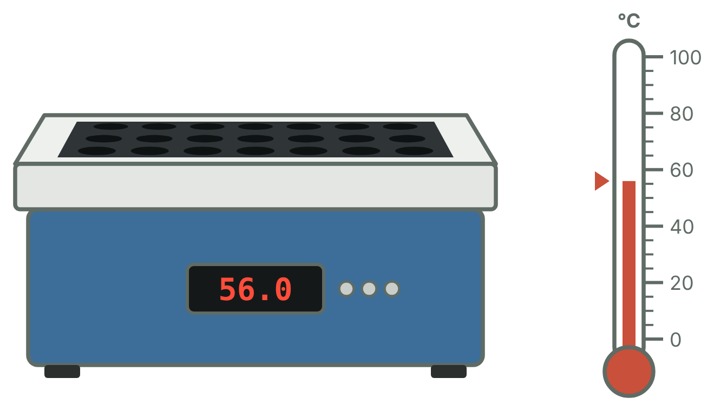

Preheat a thermal block or incubator to **56 °C**.

> <small>*Also check that ethanol has already been added to the **AW1** and **AW2** bottles (there is a box to tick on each label). If Buffer ATL or AL has white crystals in it, warm the bottle at 56 °C until they dissolve.*</small>

### Sample and tube prep

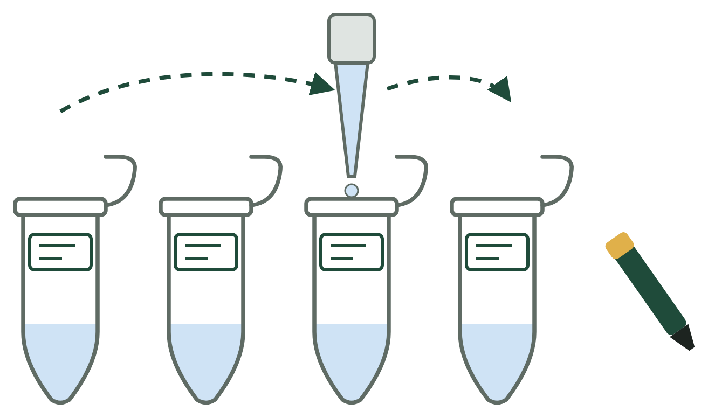

**Label** 1.5 mL microcentrifuge tubes with the sample information. These tubes will be thrown away later, but you need to be able to identify them! Label both the **side** and the **lid** of each tube. Fill each tube with **180 µL Buffer ATL**. Only **one** pipette tip is needed for this step, as long as the tip does not touch the inside of the tubes. If the tip touches anywhere inside a tube, eject it and start with a new tip for the next tube.

> <small>*Buffer ATL is a cell and tissue lysis buffer. It disrupts cell, nuclear and organelle membranes to release genomic DNA into the solution.*</small>

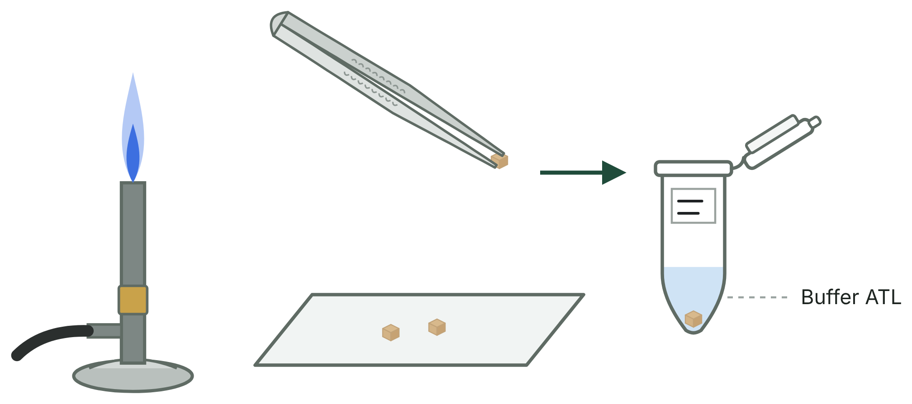

**Cut** the tissue (about 25 mg or less) into one or more small pieces. The smaller the pieces, the more surface area the enzymes have to work on. Place the tissue pieces in your labelled 1.5 mL tube.

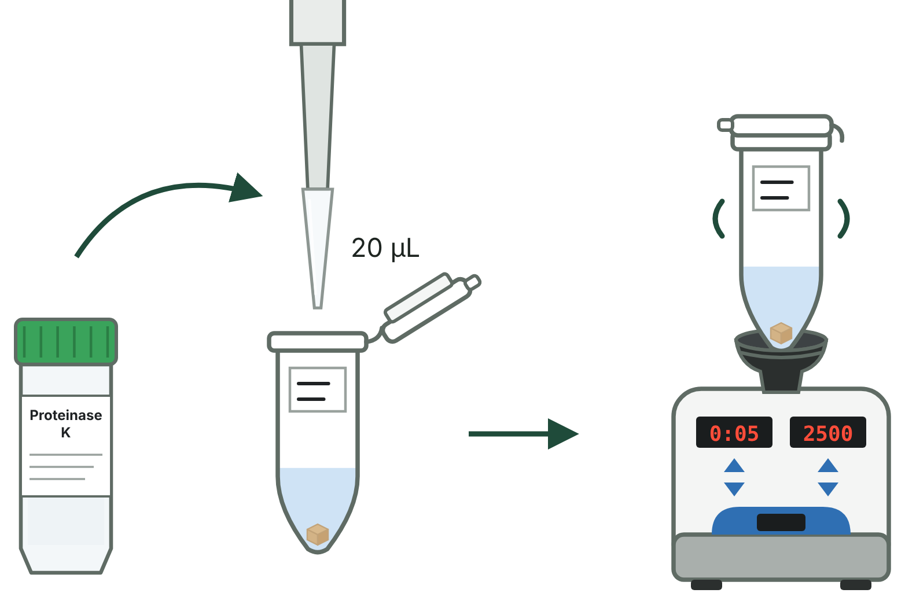

Add **20 µL proteinase K** and mix by **vortexing**.

> <small>*Vortexing mixes the solutions in your tube. It should not be excessive, because too much can shear (break) the DNA, but some mixing is needed for such small volumes.*</small>
>
> <small>*Proteinase K ("ProK" for short) is a protease: an enzyme that digests proteins. It rapidly breaks down the nucleases (DNases and RNases) that would otherwise destroy the genetic material you are trying to isolate and purify.*</small>

### Incubation

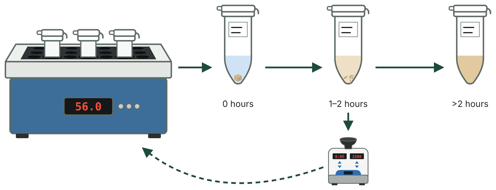

Incubate all samples at **56 °C**. We will vortex at least once during the incubation so that everything digests and mixes evenly. Keep incubating until all the tissue is **completely lysed**.

* A lysed sample is usually a completely liquid, clear or slightly tinted solution.
* Samples with a lot of pigment (for example, some liver tissue) will be darker.
* Highly keratinized samples (for example, rat tails, nails and claws, or snake shed) may not digest completely. You can still get usable DNA, but sometimes less of it.

Three hours is usually the minimum; overnight is ideal for complete digestion.

### Post-incubation tube prep

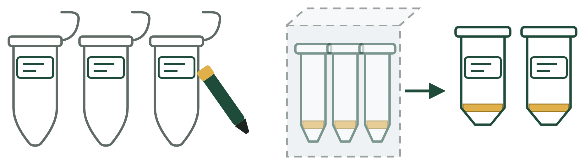

This is not an essential step, but it is one I always do to save time and organize my samples. Looking ahead in the protocol, you can see there are several steps involving multiple tubes and reagents, so it helps to prepare them now.

1. **Get the spin columns out of their packaging and label them.** Spin columns come in plastic blister packs (for more than 40 samples, unpacking can take a lot of time!). Label each column on the **lid only**. We will throw the columns away at the end, but until then you need the labels to keep track of your samples.
2. **Prepare the tubes for your final DNA extracts.** Label a new 1.5 mL tube for each sample on the **lid** and on the **side**. Use a **coloured label** on the side so your final DNA tubes are easy to tell apart from all the other tubes. Besides the catalogue number and species, it helps to add your initials and an extraction number, for example `ALK EXT 1`.

### Cell lysis and denaturation

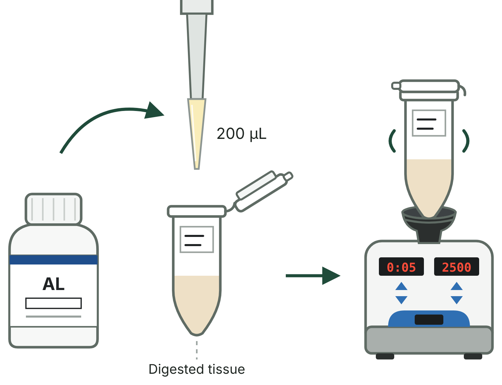

All steps after the incubation should be done in sequence for the best DNA yield. When the incubation is done, take the samples off the heat block and give them a quick vortex so the **supernatant** is well mixed. Then add **200 µL Buffer AL** and vortex again to mix.

> <small>*Buffer AL is a lysis and binding buffer that does several jobs:*</small>
>
> * <small>*Breaks open membranes: it disrupts cell membranes to release DNA into the solution.*</small>
> * <small>*Deactivates enzymes: it denatures cellular proteins, disabling the nucleases that would otherwise break down your newly released DNA.*</small>
> * <small>*Helps purification: it creates a high-salt environment, so the DNA will bind tightly to the silica filter of the spin column. The later washes can then remove cell debris* without *washing away your DNA.*</small>

### Precipitation

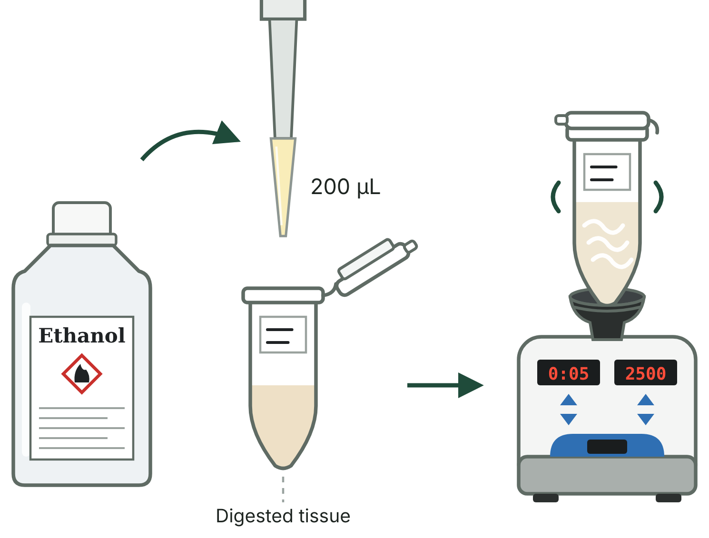

Add **200 µL ethanol (96–100%)** and mix thoroughly by vortexing. You will immediately notice some of your samples change colour and consistency. That is a good thing :)

> **Note:** ethanol is not very viscous, so it drips easily from the pipette tip and the top of the tube. Take care not to cross-contaminate your samples!

> <small>*Ethanol changes the properties of the water in your tube. This matters because DNA molecules are negatively charged. Ethanol strips water away from the DNA, so the salts from Buffer AL can bind to it and neutralize its charge. This is what makes the DNA stick to your filter!*</small>

### Bind DNA to the filter

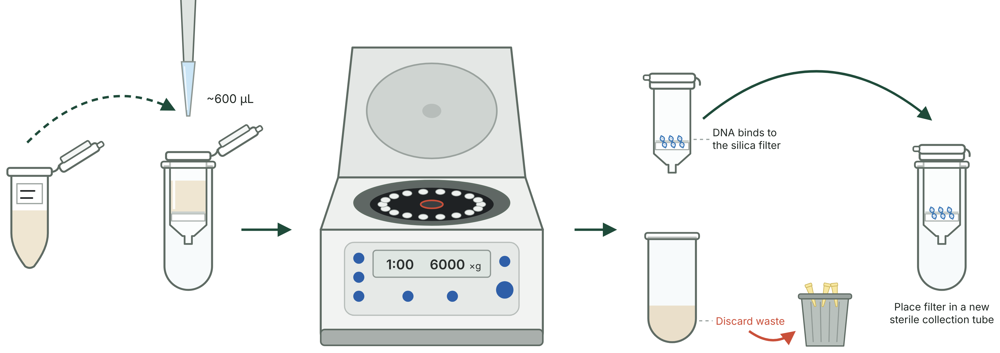

Next, set your pipette so it will take up all of the solution. We have already added 200 µL of ATL and proteinase K, 200 µL AL and 200 µL ethanol, so there is about **600 µL** in each tube: set your P1000 to at least 600 µL. You can do one big transfer or two smaller ones. *Which works best?* Remember that your solution contains a lot of ethanol, so it will drip. Be careful! Pipette the mixture (including any precipitate) into a **DNeasy Mini spin column** placed in a 2 mL collection tube. **Be careful to avoid cross-contaminating samples!**

**Centrifuge** the spin columns at **≥ 6,000 × g (8,000 rpm) for 1 minute**. Take the tubes out of the centrifuge and *throw away* **only** the collection tube and the liquid in it. Keep your spin column: that's your DNA! Place the spin column in a brand-new collection tube.

### Washing and purifying I

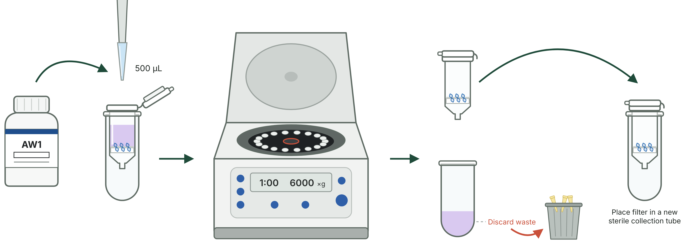

Add **500 µL Buffer AW1**. Be careful not to mix this up with AW2! Centrifuge for **1 minute at ≥ 6,000 × g**. Then repeat what we did before: throw away the collection tube and the liquid, and place the spin column in a new 2 mL collection tube.

> <small>*AW1 is the first of two special wash buffers that clean the DNA while it is bound to the spin column membrane. It breaks down and washes away leftover proteins, denatured enzymes and pigments, while the DNA stays bound to the filter. So the liquid you throw away here is the stuff we* **don't** *want, and the spin column holds our precious trapped DNA!*</small>

### Washing and purifying II

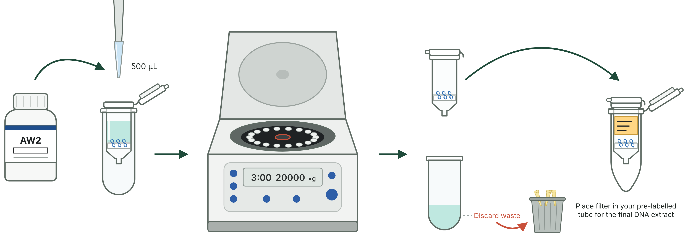

Add **500 µL Buffer AW2** and centrifuge for **3 minutes at 20,000 × g (14,000 rpm)**. At this speed the centrifuge will be loud! Make sure it is balanced, or your tubes might crack. Again, discard the liquid and the collection tube. **But** this time, instead of a new collection tube, put your spin column into one of your **relabelled 1.5 mL microcentrifuge tubes**.

> <small>*Buffer AW2 contains more ethanol than AW1, but none of AW1's special salts. This is really important! AW2 dissolves away the salts left behind by AW1 (which got rid of all the garbage), while the ethanol keeps the DNA on the filter. This prepares the DNA for the next step, where we get it* off *the filter!*</small>

### Elution

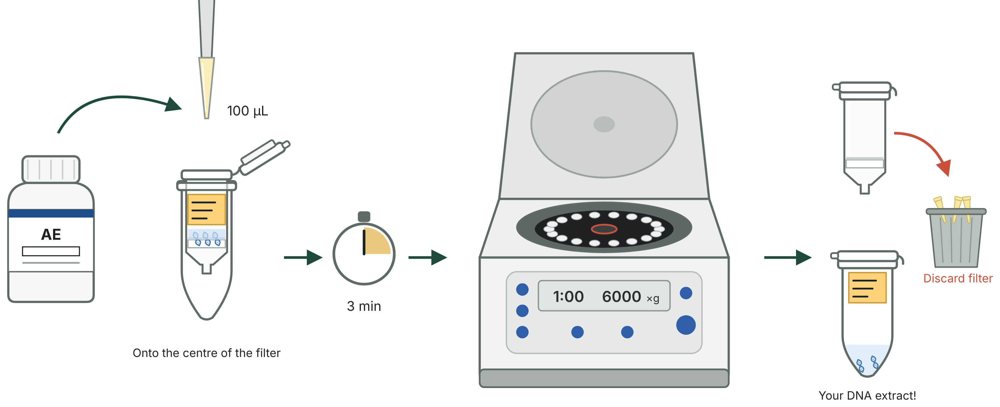

Next, **elute** the DNA by adding **100 µL Buffer AE** to the centre of the spin column membrane. Leave the liquid on top of the filter for **3 minutes** at room temperature (15–25 °C). Then centrifuge for **1 minute at ≥ 6,000 × g**.

> <small>*Buffer AE, the elution buffer, works in two ways:*</small>
>
> 1. <small>*The shift (low salt): AE is a low-salt solution. When it is added to the column, the lack of salt ions breaks the chemical bridge holding the DNA to the silica.*</small>
> 2. <small>*Rehydration and release: AE rehydrates the DNA molecules. Because DNA is highly soluble in water, it lets go of the filter and dissolves completely into the buffer.*</small>

> <small>*Optional: this step is flexible! You can change it to get a higher DNA yield or a higher concentration. Repeating the elution increases the total yield, but it also dilutes your sample. One way around this is to elute twice with a smaller volume: add a second 100 µL of AE and spin again into the same tube. The final volume is still 200 µL, but two elutions get more of the DNA off the filter.*</small>

### Hooray!

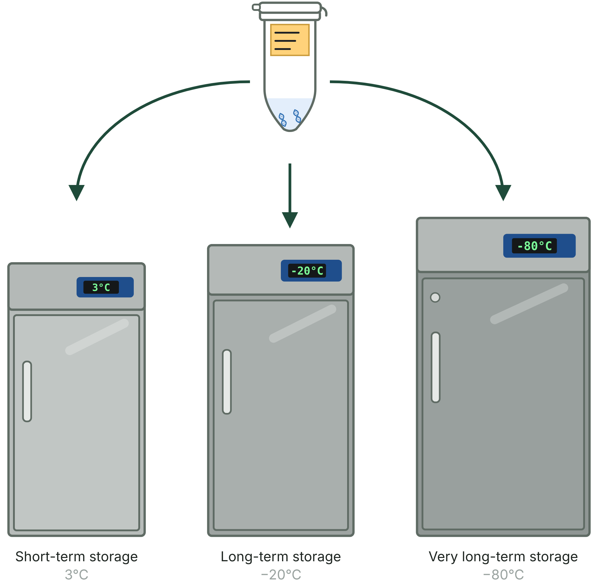

**Do not throw away this tube: it now contains your genomic DNA extract!**

* **Short-term storage:** keep extracts in the fridge at **3 °C**.
* **Long-term storage:** keep extracts in the freezer at **−20 °C**.
* **Very long-term storage:** keep extracts in the **−80 °C** freezer.

Avoid repeated freeze–thaw cycles (for example fridge to freezer to fridge): they damage the DNA in your sample and give lower-quality sequencing results later on.

### Record your extraction

Write the details of every extract in your **lab notebook** *and* in the lab's **digital spreadsheet**, so that anyone can find the sample again later:

| Extract number | Extraction date | Species | Tissue type | Storage location |
|---|---|---|---|---|
| ALK EXT 1 | 11 Nov 2026 | *Nesomys lambertoni* (UADBA 43227) | Liver in EtOH | −20 °C freezer, box 1 |

The extract number always goes in the first column, and it must match the label on your tube.

Next, we will measure the total amount of DNA in each of our samples. Good luck!

### Quiz: DNA extraction

**1. You check on your extraction after it has been incubating for 2 hours, and you see pieces of tissue still in the solution. What should you do?**

* **A)** Take it off the heat block and go on to the next step. Incubating for more than 2 hours is bad for the DNA.
* **B)** Vortex your sample, then put it back on the heat block and keep incubating until the tissue is completely digested.

<b>Answer</b> <i>(click to check)</i>

**B.** The tissue is not fully digested yet, so DNA is still trapped inside it. Vortex to mix and break up the pieces, then keep incubating. A longer incubation does not hurt the DNA: **overnight is ideal**, and proteinase K is protecting your DNA the whole time. If you stop too early, you will get less DNA.

<b>2. What does proteinase K do, and how does that protect your DNA?</b> <i>(click for the answer)</i>

Proteinase K is an enzyme that **digests proteins**. It breaks down the **nucleases** (DNases) that would otherwise cut up your DNA.

<b>3. Why do we add ethanol before putting the sample on the spin column?</b> <i>(click for the answer)</i>

Ethanol strips water away from the DNA, so the **salts** from Buffer AL can neutralize its negative charge. This lets the DNA **stick to the silica filter**.

<b>4. After the first spin, what do you throw away: the spin column or the collection tube?</b> <i>(click for the answer)</i>

The **collection tube and the liquid in it.** Your DNA is stuck to the filter in the **spin column**, so keep it!

<b>5. What is the difference between Buffer AW1 and Buffer AW2?</b> <i>(click for the answer)</i>

**AW1** washes away leftover proteins, enzymes and pigments. **AW2** washes away the **salts** left behind by AW1. Both contain ethanol, so the DNA stays on the filter.

<b>6. Why does Buffer AE make the DNA come off the filter?</b> <i>(click for the answer)</i>

AE is **low in salt**, so the salt "bridge" holding the DNA to the silica breaks. The DNA **rehydrates** and dissolves into the buffer.

<b>7. Why is the spin column put into a labelled 1.5 mL tube (not a collection tube) before the elution spin?</b> <i>(click for the answer)</i>

The liquid that comes through in this spin **is your DNA**. It must go into a clean, labelled tube that you keep, not into a collection tube that gets thrown away.

<b>8. Where should you store your DNA tonight? And for the next year?</b> <i>(click for the answer)</i>

Tonight (short term): the **fridge, 4 °C**. For a year (long term): the **freezer, −20 °C**. Avoid thawing and freezing it many times.

## Part 4: Other sample types, other kits

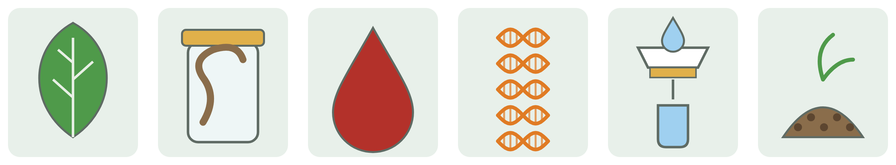

The DNeasy Blood & Tissue Kit works well for fresh or ethanol-preserved animal tissue. Other kinds of samples need different kits. The four basic steps (lyse, bind, wash, elute) stay the same, but the lysis and clean-up are changed for the sample.

| Sample type | Problem | A commonly used kit | Notes |
|---|---|---|---|
| Animal tissue, nucleated blood (reptiles, birds, amphibians) | None: this is today's kit | [Qiagen DNeasy Blood & Tissue](https://www.qiagen.com/us/products/discovery-and-translational-research/dna-rna-purification/dna-purification/genomic-dna/dneasy-blood-and-tissue-kit) | Use 5–10 µL of nucleated blood |
| Plants (leaves, including chloroplast DNA) | Tough cell walls; chemicals (polysaccharides, polyphenols) that block PCR | [Qiagen DNeasy Plant Pro](https://www.qiagen.com/us/products/discovery-and-translational-research/dna-rna-purification/dna-purification/genomic-dna/dneasy-plant-pro-kits) | Tissue is ground with beads. The DNA includes the chloroplast genome, used for plant barcodes (*rbcL*, *matK*). CTAB extraction is a cheap alternative. |
| Formalin-fixed tissue (museum specimens, FFPE) | DNA is broken into short pieces and cross-linked to proteins | [Qiagen QIAamp DNA FFPE Tissue](https://www.qiagen.com/us/products/discovery-and-translational-research/dna-rna-purification/dna-purification/genomic-dna/qiaamp-dna-ffpe-tissue-kit) | Long Proteinase K digestion plus a heat step. Expect short fragments and low yield. Always take a tissue sample **before** fixing a specimen. |
| Very long DNA for genome sequencing (PacBio, Oxford Nanopore) | Columns and vortexing break DNA into short pieces | [NEB Monarch HMW DNA Extraction Kit for Tissue](https://www.neb.com/products/t3060-monarch-hmw-dna-extraction-kit-for-tissue) | Gentle handling, no vortexing. Needs fresh or frozen tissue. PacBio Nanobind kits are another option. |
| Environmental DNA (eDNA) from water | Very little DNA, mixed with chemicals that block PCR | [Qiagen DNeasy PowerWater](https://www.qiagen.com/us/products/discovery-and-translational-research/dna-rna-purification/dna-purification/microbial-dna/dneasy-powerwater-kit) | Water is first filtered; the filter is extracted. Sterivex filters have their own kit. Controls are essential because contamination is easy. |
| Soil, sediment, faeces | Humic acids and other inhibitors | [Qiagen DNeasy PowerSoil Pro](https://www.qiagen.com/us/products/discovery-and-translational-research/dna-rna-purification/dna-purification/microbial-dna/dneasy-powersoil-pro-kit) | Bead beating plus an inhibitor-removal step |

Other companies (Zymo, Macherey-Nagel, Thermo Fisher, NEB and others) make kits for each of these sample types.

## Questions for discussion

1.) What is the difference between the first stop and the second stop?

2.) What would happen if we forgot to add Proteinase K to the lysis buffer?

3.) You need DNA from a snake that was fixed in formalin in 1950. What problems do you expect?

4.) A colleague wants to sequence a whole genome with long reads. Why is today's kit not the best choice?

### Record your extraction

> Genomic DNA was extracted from [tissue type] preserved in [95% ethanol / DMSO buffer] using the Qiagen DNeasy Blood & Tissue Kit, following the manufacturer's protocol for animal tissues (lysis at 56 °C for [time]; elution in [volume] µL Buffer AE). DNA concentration was measured with a Qubit fluorometer using the Biotium [kit name] assay.

## Troubleshooting

| Problem | Likely cause | What to do |
|---|---|---|
| Tissue has not dissolved after 3 hours | Piece too big, or tough tissue (skin, scales) | Cut smaller; add 20 µL more Proteinase K; incubate longer |
| The column is blocked; liquid stays on top | Too much tissue, or undigested pieces | Spin longer; next time use less tissue |
| Liquid touched the column after the last spin | Collection tube too full | Empty it and spin again for 1 minute |
| Very low DNA (Qubit) | Little tissue, old sample, or ethanol left on the membrane | Elute in less buffer; elute a second time; make sure the dry spin was 3 minutes |
| Pipette volume looks wrong | Tip loose, plunger released too fast, or pipette past its range | Push the tip on firmly; release slowly; check the range |
| Liquid inside the pipette | Pipette laid down or turned over with liquid in the tip | Tell an instructor; do not keep using it |

## References

* QIAGEN (2023). DNeasy Blood & Tissue Handbook. Available at [qiagen.com/handbooks](https://www.qiagen.com/handbooks).
* Taberlet, P., Bonin, A., Zinger, L., & Coissac, E. (2018). [*Environmental DNA: For Biodiversity Research and Monitoring*](https://doi.org/10.1093/oso/9780198767220.001.0001). Oxford University Press.

### Continue the workshop

* Next: [Module 1: Sequence editing](Module1-sequence-editing-lab.html)
* [Madagascar 2026 workshop home](https://fieldtophylogeny.github.io/Madagascar2026/)

