---
# DNA Quantification

After extraction, your DNA is in a tube of clear liquid, so how do you know if the extraction worked? We **measure how much DNA (dsDNA) is in each tube** with a small fluorometer called the **Qubit** and the **AccuGreen Broad Range (BR) dsDNA assay** (Biotium).

> <small>*How it works: the Quantification Solution contains a dye that fluoresces only when it is bound to double-stranded DNA. The Qubit excites the dye with light and measures the fluorescence. More DNA = more fluorescence. Two **standards** with a known amount of DNA (0 and 100 ng/µL) tell the Qubit what "no DNA" and "a lot of DNA" look like, and it calculates your sample from these.*</small>

### Learning objectives

By the end of this module you should be able to:

1. Explain the importance of quantifying DNA extracts
2. Carry out the Biotium Quantification Assay and use the Qubit Fluorometer to calculate stock concentration for samples

## 0. Meet the Qubit

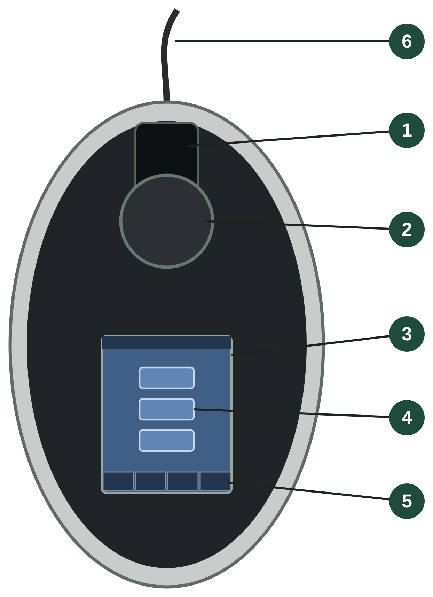

We use a **Qubit 2.0 Fluorometer**. The arrows (▲ ▼) and **GO** are on the touchscreen.

| # | Part (EN) | Partie (FR) | What it does |
|---|---|---|---|
| 1 | Sample chamber | Chambre à échantillon | The assay tube goes in here |
| 2 | Lid (slides) | Couvercle (coulissant) | Must be **closed** for every reading — light from the room ruins the measurement |
| 3 | Touchscreen | Écran tactile | Touch to choose and run the assay |
| 4 | Menu: DNA / RNA / Protein | Choix du test | Highlight **DNA** with ▲ ▼, then press **GO** |
| 5 | Tabs: Home / Standards / Sample / Data | Onglets | Move between screens; **Data** shows past readings |
| 6 | Power cable | Câble d'alimentation | |

---
> **Practice first!** Open [**QubitLab**](QubitLab.html) and run the whole assay on a cartoon Qubit: prepare the tubes (**1–10 µL DNA**, solution to 200 µL — we use 5 µL), choose the settings, calibrate, read three samples and calculate their stock concentration. It works offline and in French (**FR** button).

## 1. Gather components

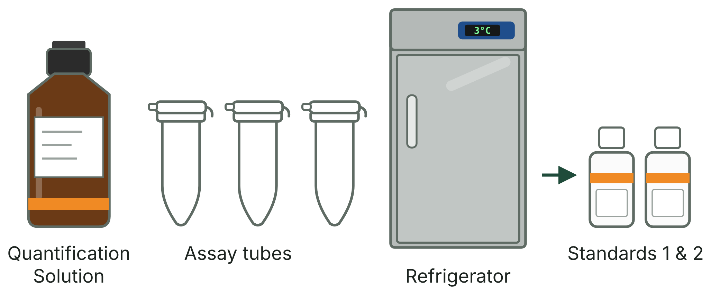

**All Broad Range dsDNA components are marked with orange tape.**

1. **AccuGreen BR dsDNA Quantification Solution** — the dark brown bottle. It already contains the dye.
2. **AccuGreen Standard 1 (0 ng/µL)** and **Standard 2 (100 ng/µL)** — two small bottles, labeled "BR" on top, kept in the refrigerator.
3. **Qubit assay tubes** — thin-walled, clear 0.5 mL tubes.
4. Your DNA extractions from this morning.

> <small>*The bottle is brown because the dye is sensitive to light. Keep it closed and out of bright light when you are not using it.*</small>

---

## 2. Warm everything to room temperature

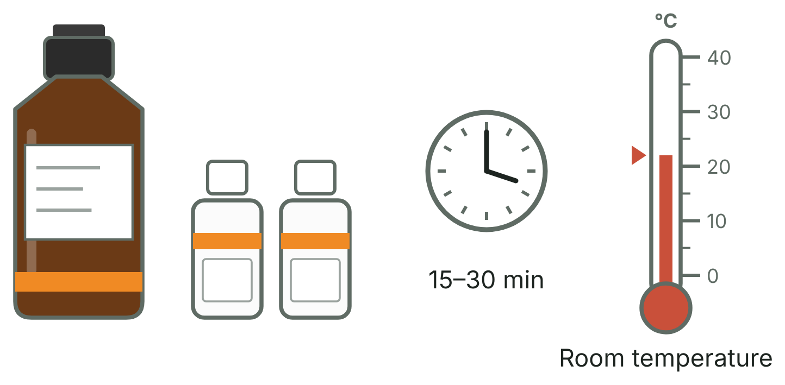

1. Let the Quantification Solution and both standards sit on the bench until they are at **room temperature** (about 15–30 min).

> <small>*The dye's fluorescence changes with temperature. If the standards are cold and the samples are warm, the Qubit compares things that are not equal and your numbers will be wrong.*</small>
---

## 3. Label the assay tubes

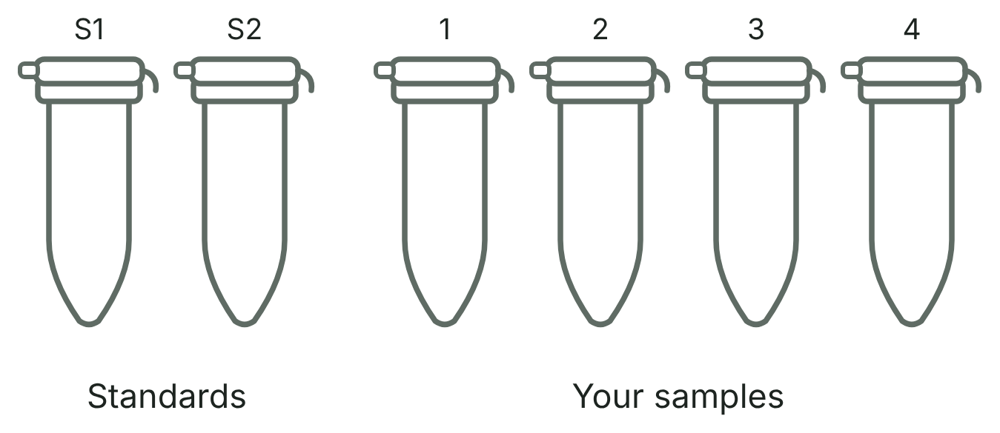

You need **one 0.5 mL tube for each sample + one for Standard 1, and one for Standard 2.** (so for 8 extracts, you will have 10 tubes)

1. Write on the **lid only** (e.g. S1, S2, then your sample numbers).

> <small>*The Qubit reads light through the **side** of the tube. Marker ink on the side blocks light and give a wrong (lower) reading.*</small>

---

## 4. Prepare the standards

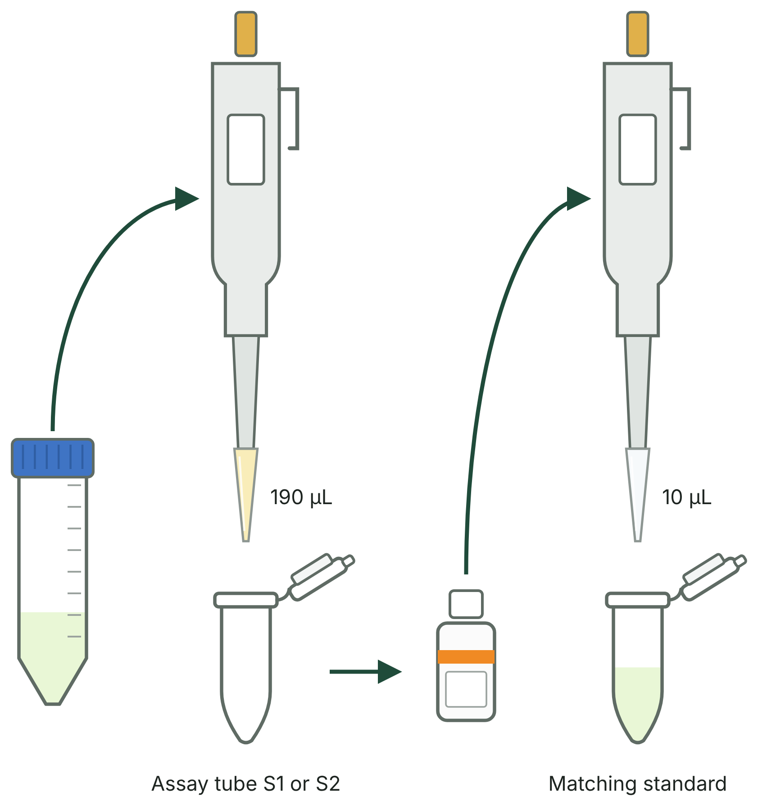

For **Standard 1** and **Standard 2**:

1. Add **190 µL** of Quantification Solution to each standard tube (P200).
2. Add **10 µL** of the matching standard to its tube (P10 or P20). Use a new tip for each.
3. Vortex both samples

> <small>*190 + 10 = 200 µL total. Every tube must have the same final volume of 200 µL.*</small>

---

## 5. Prepare the samples

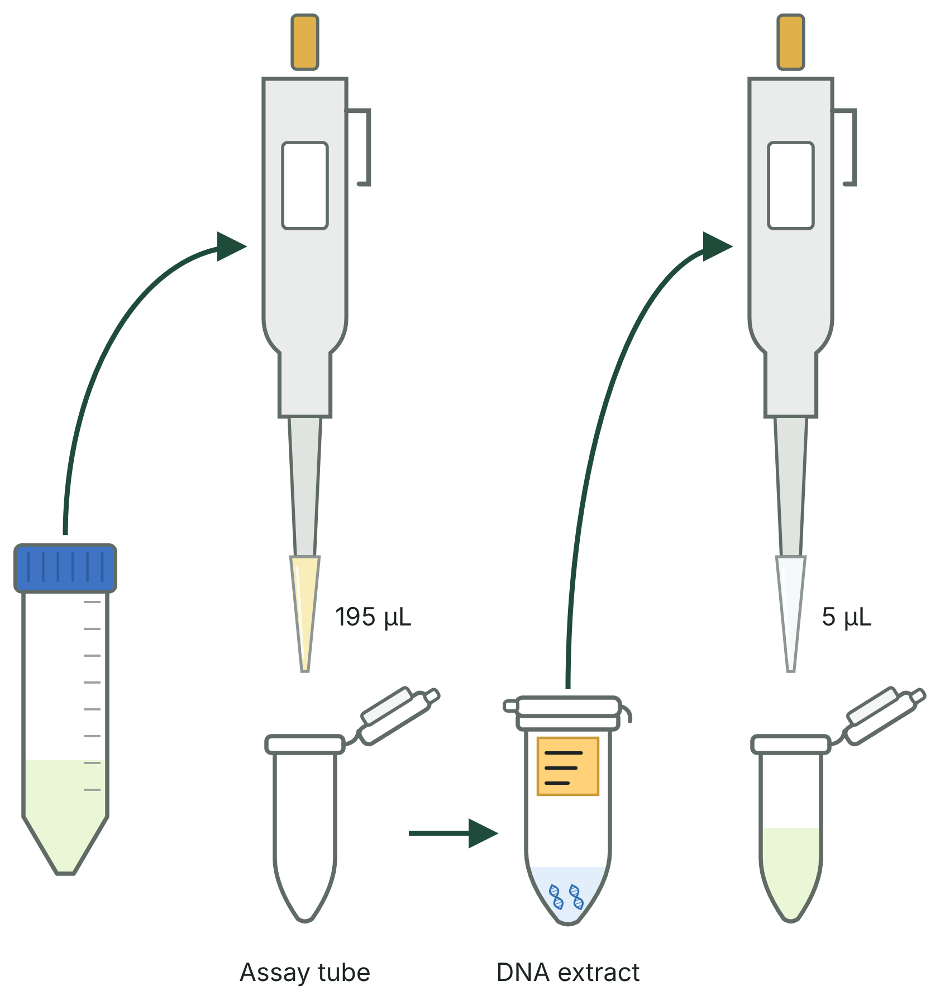

For each sample:

1. Add **195 µL** of Quantification Solution to the assay tube (P200).
2. Add **5 µL** of your DNA (P10 or P20). New tip for every sample!

> <small>*You can use between **1 to 10 µL** of DNA; just add Quantification Solution to make **200 µL** in total (e.g. 199 + 1, 195 + 5, 190 + 10). We use 5 µL because tiny volumes like 1 µL are hard to pipette accurately. **Write down how many µL you used**, because you will enter this number on the Qubit.*</small>

---

## 7. Mix and incubate

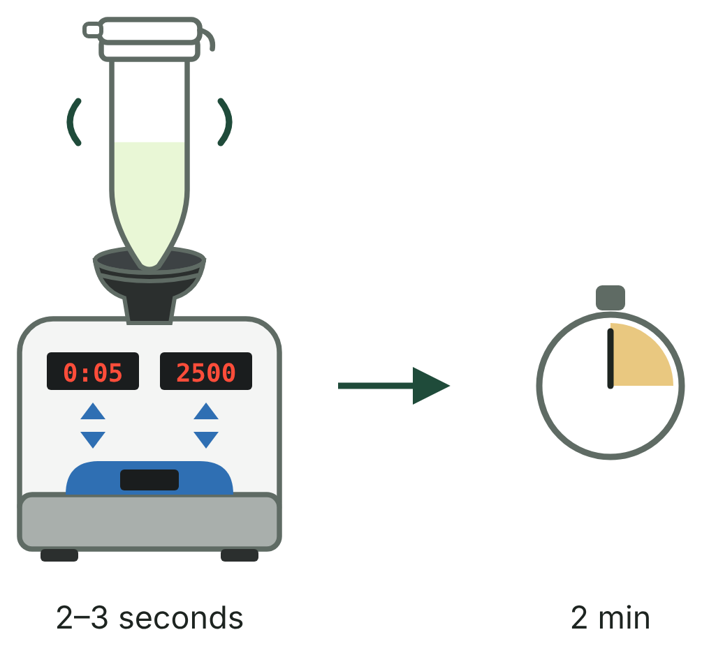

1. **Vortex** each tube for 2–3 seconds to mix well.
2. Quick spin if there are drops on the lid or walls.
3. Leave at **room temperature for 3 minutes**. Use the timer.

> <small>*The dye needs a short time to find and bind to the DNA. Reading too early gives a value that is too low.*</small>

---

## 8. Home screen: choose the assay

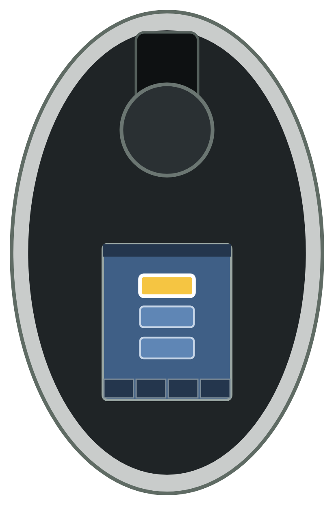

When you power on the instrument, the screen shows the main options: **DNA**, **RNA** and **Protein**.

1. Use the arrow keys (▲ or ▼) to highlight **DNA**. Press **GO**.
2. On the next menu, highlight **dsDNA** (double-stranded DNA). Press **GO**.
3. Select your kit: **Broad Range**. Press **GO**.

> <small>*Choose **Broad Range**, not High Sensitivity. The Qubit must use the setting that matches the kit in your tubes, or the calculation will be wrong.*</small>

---

## 9. Calibration choice

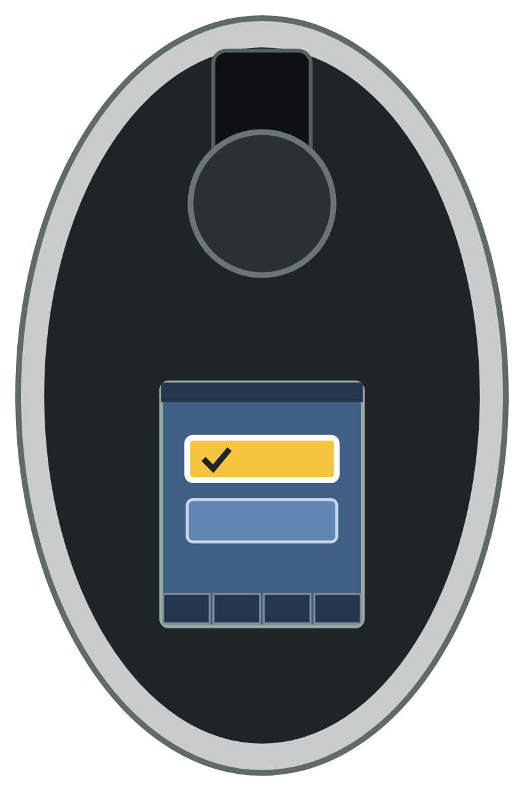

The Qubit asks you to choose:

- **Run New Standard**: choose this if you just prepared a fresh batch of Quantification Solution.
- **Use Existing Calibration**: choose this **only** if you are measuring more tubes made earlier today from the **exact same** tube of Quantification Solution that was already calibrated.

Use the arrows to select, and press **GO**.

> <small>*The calibration belongs to one batch of solution. A new batch can fluoresce a little differently, so it needs new standards.*</small>

---

## 10. Measure the standards

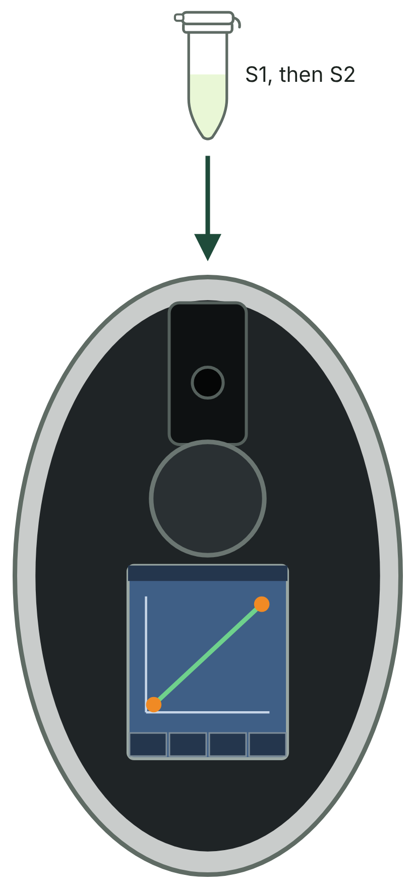

1. Insert **Standard #1** (the blank, 0 ng/µL) into the sample chamber.
3. Press **GO**. The screen shows *Reading…*
4. When prompted, remove Standard #1. Insert **Standard #2** (100 ng/µL), close the lid, and press **GO**.

The Qubit now draws a **calibration line** through the two standards. Check that the line goes up from Standard #1 to Standard #2, then press **GO** to go to the sample screen.

> <small>*Standard #1 tells the Qubit how much fluorescence there is with **no** DNA (the background). Standard #2 shows how much fluorescence a **known** amount of DNA gives. Your samples are measured on the line between these two points.*</small>

---

## 11. Read your samples and calculate the concentration

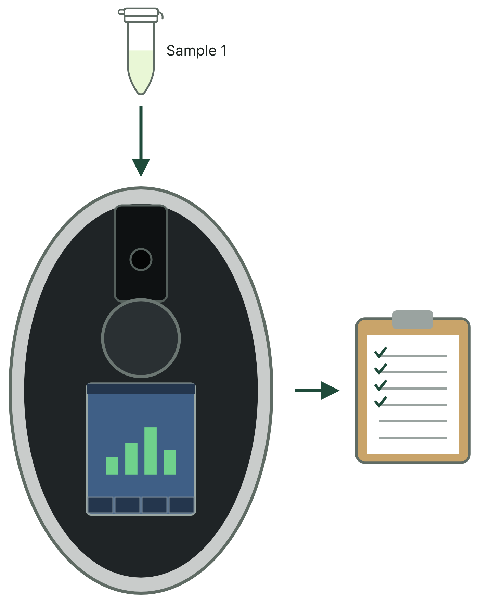

The screen shows **Insert Sample**.

1. Insert your first sample tube, close the lid, and press **GO**.
2. The first number on the screen is the concentration **in the assay tube** (diluted: your DNA is now in 200 µL).
3. Press **Calculate Stock**.
4. Use ▲ and ▼ to enter the volume of DNA you added to the tube: **5 µL** (or whatever volume you used).
5. Choose the units: **ng/µL**.
6. The screen now shows the **stock concentration**: the concentration in your original extraction tube. **Write it down** next to the sample number.
7. Repeat for every sample.

> <small>*Why "Calculate Stock"? You put only 5 µL of DNA into 200 µL, so the DNA in the assay tube is 40 times more dilute than in your extraction tube. The Qubit corrects for this when you tell it the volume.*</small>**.

---

## 12. Finish

1. Write your Qubit results (DNA concentrations) in the handout table.
2. Throw away the assay tubes. Put the standards/extracts back in the refrigerator.

---

## Discussion Questions

1. Why do we label the lid and not the side of the tube?

2. Your sample reads 0.8 ng/µL. Name two possible reasons.

## References

<small>Biotium. AccuGreen™ Broad Range dsDNA Quantitation Kit — product information. <https://biotium.com></small>

### Continue the workshop

* Next: [Introduction to Barcoding](Intro-Barcoding.md)
* [Madagascar 2026 workshop home](https://fieldtophylogeny.github.io/Madagascar2026/)

