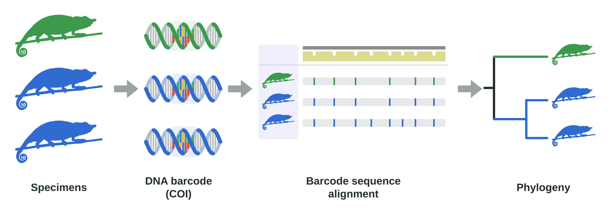
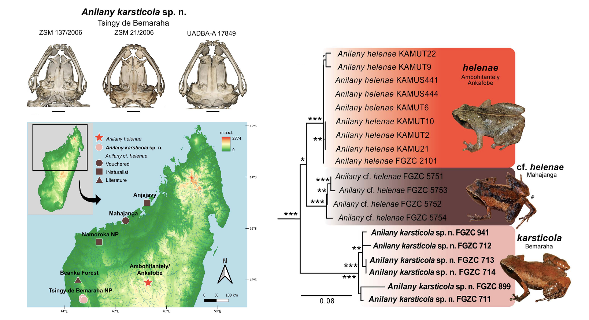
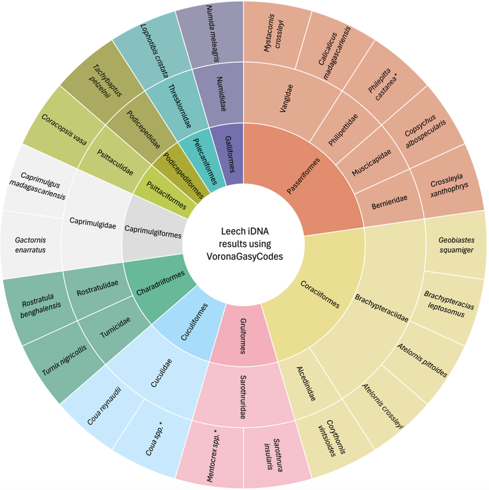
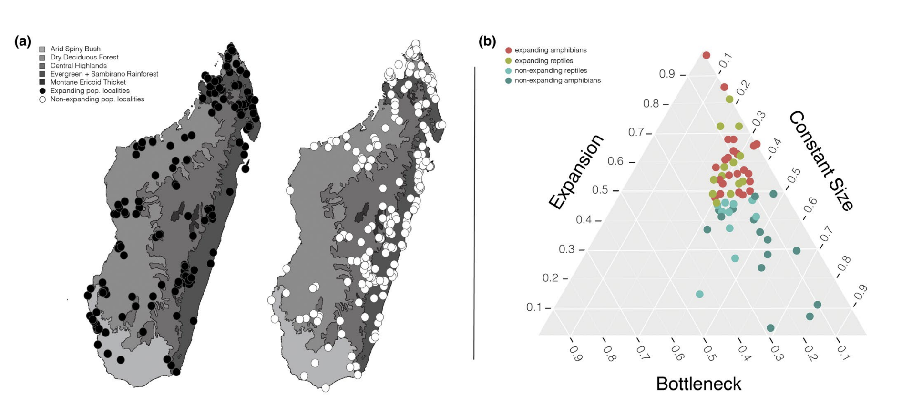

## *Exploring molecular phylogenetic methods for rapidly assessing biodiversity*  
### What is Barcoding?
DNA barcoding was developed formally in 2003 and refers to the process of sequencing a fast-evolving part of the mitochondrial genome. One of the most commonly used markers is **Cytochrom Oxidase I** or **CO1**.  

The core concept of DNA barcoding is to make use of large libraries with other mitochondrial markers that we can use to identify species, and it is often (1) fast, (2) realiable and (3) cost efficient.  

### What are the limitations?

The limitations of barcoding are related to how good the database for comparison is: if you have 10 undescribed species, and use a database to search for similar sequences, you may not find much information about your mystery species. How will, however, be able to build evidence that the species has not yet been descrbied.

Barcode data can be used for many downstream applications (for example: [building phylogenetic trees](https://orca.cardiff.ac.uk/id/eprint/175691/), [species inventories](https://onlinelibrary.wiley.com/doi/10.1002/edn3.474), [tracking illegal wildlife trade](https://www.sciencedirect.com/science/article/pii/S266693742400009X), but it is still limited as mtDNA only represents **maternal inheritance**, and a **single locus** in the mtDNA (not nuclear) genome. If your downstream goals are to build well-resolved phylogenies for recently evolved species, [look at ancient reticulation](https://academic.oup.com/evolut/article/77/4/931/6998222), or reconstruct biogeographic histories, you may need additional molecular or other supporting data.

> **Figure adapted from Petzold et al 2025. Multiple lines of evidence (morphology, geography, mtDNA + nuDNA) used to identify a new microhylid frog species from Tsingy de Bemaraha, including barcode marker COI**

Developing these libraries not only helps species identification in the present, but has shown important long-term use in unexpected ways. For example, [Reddy et al. 2025]((https://onlinelibrary.wiley.com/doi/full/10.1111/1755-0998.70027)) used a library of Vanga bird barcodes to identify parasite hosts using invertebrate-derived DNA (iDNA) collected from leeches!

>  **Figure from Reddy et al. 2025. Vanga bird species identifications listed were derived from barcoded leech blood meals** 

### What does the future of barcoding look like?
In Madagascar, biodiversity is rich, and many species still remain undocumented and undescribed. New methods for increasing the speed, transportability and accuracy of barcode data to quickly identify species or the species present in an environmental DNA sample will be important for conservation, management, and biodiversity discovery.

Although more high throughput sequencing method are becoming less expensive, they are not always the correct or most cost efficient way to rapidly assess biodiversity, confirm sample identity when morphology is unclear, or develop tools that can be used for long term conservation management.

## I am planning a project with RADseq data, Ultraconserved Elements (UCEs), or whole genome data. Do I still need barcodes?
In short, it depends!

If you wish to contribute to larger databases and initiatives so other studies can readily access and use your barcodes, this becomes an important step. For example, we published a study examining population expansion and bottlenecks is Malagasy reptiles & amphibians using only barcode data already submitted to public repositories (**Kuhn et al. 2022**)

>  **Figure from Kuhn et al. 2022. (a) Dots on map are barcoded localities for >20 species. (b) Barcodes used to identify expanding and contracting populations** 

By barcoding your samples before high throughput sequencing, you can identify cryptic or misidentified samples, thus saving money or time later on by preventing submission of incorrect samples. For example, in [Williams et al. 2020](https://www.nature.com/articles/s41437-019-0260-9), the methods state: 
> <small>*"To investigate species boundaries between our samples, we first confirmed the species assignment of our individuals using mtDNA barcoding. We used cytochrome c oxidase subunit II (COII) sequencing and NCBI Genbank to access a subset of COII sequences from across the Cheirogaleus clade."*</small>

However, depending on the quality of your genome data, it is possible to extract the same COI data you would get by barcoding your samples initially.

## References
* Kuhn, Arianna, Marcelo Gehara, Mamy SM Andrianarimalala, Nirhy Rabibisoa, Bernard Randriamahatantsoa, Isaac Overcast, Christopher J. Raxworthy, Sara Ruane, and Frank T. Burbrink. "Drivers of unique and asynchronous population dynamics in Malagasy herpetofauna." [Journal of Biogeography 49, no. 4 (2022): 600-616](https://onlinelibrary.wiley.com/doi/pdfdirect/10.1111/jbi.14315).
* Petzold, Alice, Frank Glaw, Katherine E. Mullin, Andolalao Rakotoarison, Achille P. Raselimanana, Angelica Cottini, Pablo Orozco-terWengel et al. "A preliminary assessment of the diversity in the frog genus' Anilany'(Microhylidae: Cophylinae) with description of a new species from western Madagascar." [Salamandra 61, no. 1 (2025): 70-94](https://orca.cardiff.ac.uk/id/eprint/175691/).
* Williams, Rachel C., Marina B. Blanco, Jelmer W. Poelstra, Kelsie E. Hunnicutt, Aaron A. Comeault, and Anne D. Yoder. "Conservation genomic analysis reveals ancient introgression and declining levels of genetic diversity in Madagascar’s hibernating dwarf lemurs." [Heredity 124, no. 1 (2020): 236-251](https://www.nature.com/articles/s41437-019-0260-9).
* DeBaun, Dylan, Nirhy Rabibisoa, Achille P. Raselimanana, Christopher J. Raxworthy, and Frank T. Burbrink. "Widespread reticulate evolution in an adaptive radiation." [Evolution 77, no. 4 (2023): 931-945](https://academic.oup.com/evolut/article/77/4/931/6998222).
* Reddy, S., Wacker, K., Fahmy, M., Hekkala, E., Bates, J.M., Goodman, S.M., Hackett, S.J., Raherilalao, M.J. and Maddox, J.D., 2025. VoronaGasyCodes: a public database of mitochondrial barcodes for Malagasy birds. [Molecular Ecology Resources, 25(8), p.e70027](https://onlinelibrary.wiley.com/doi/full/10.1111/1755-0998.70027).
* Rakotonirina, Tahinarizaka Jenny, Erika Viljoen, Jean Michel Leong Pock Tsy, and Tendro Radanielina. "Validation of ITS barcode for the identification of CITES Malagasy Dalbergia (Fabaceae) species." [Forensic Science International: Animals and Environments 5 (2024): 100089.](https://www.sciencedirect.com/science/article/pii/S266693742400009X)

### Return to home page:  
* [Field2Phylogeny home](https://fieldtophylogeny.github.io/)
