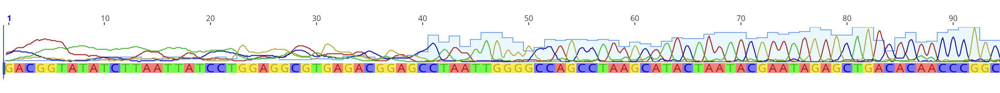
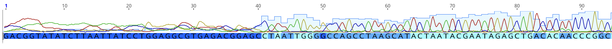
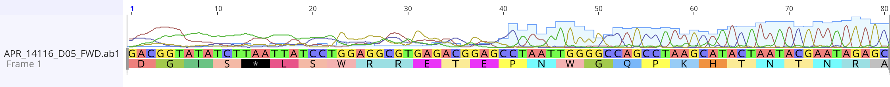
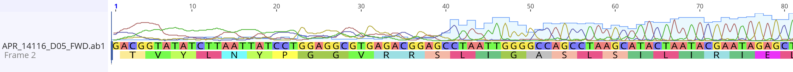
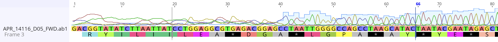

# Sequence editing
## Raw sequence files  
After Sanger sequencing, files are usually returned in raw format (with the extension ".ab1" or ".scf"). This raw format can be visualized as a chromatogram. This allows a quality control check to identify the quality of the sequence results, individual base calls, and the certainty of each base call. 

Here is a Chromatogram (visual trace plot) visualized in [Geneious Prime](https://www.geneious.com/features/prime#sequence-analysis) (Proprietary software, but free trial versions available). This shows fluorescent signal intensity (peak height) and base calls (codon letters; A, T, G, & C):

Base quality is tracked for each nucleotide position (here, this is viewed by shade of blue as well as by light blue quality bars):

Often, two raw files are produced per individual: the forward sequence, and the reverse sequence. These two sequences can be put together as a singe contiguous sequence (a "contig"), where both sequences overlap to account for low quality bases at the ends of the sequence.  

## Sequence translation
These sequences can be translated into protein coding sequences - for every 3 _nucleotides_ (basepairs) there is a corresponding _codon_. Strings of codons make amino acids. Many amino acids make a protein. Here, we sequenced a fragment of a larger gene. Thus, multiple reading frames must be checked for the correct translation - if there is a stop codon, then this isn't the correct reading frame, because a stop codon would terminate the sequence, and the amino acid would not be built.

**Reading Frame I**  
  

**Reading Frame II** 

**Reading Frame III** 
  

_Which reading frame is correct for this pair of sequences?_

## Exercise 1
Now, let's download our raw .ab1 files and view the chromatograms in the TraceLab Viewer:  

Group A:  
[Mystery-Sequence-A-Forward.ab1](data/APR_13144_B05_FWD.ab1)  
[Mystery-Sequence-A-Reverse.ab1](data/APR_13144_B05_RVS.ab1)  

Group B:  
[Mystery-Sequence-B-Forward.ab1](data/APR_14116_D05_FWD.ab1)   
[Mystery-Sequence-B-Reverse.ab1](data/APR_14116_D05_RVS.ab1)   

Open [TraceLab Chromatogram Viewer](TraceLab-V2.html) then follow these steps:

## Exercises
1.) After uploading your forward and reverse sequences to the viewer, how many basepairs were ambiguous?  
2.) What quality score works best for your alignment: strict, regular, or relaxed? how many basepairs of difference are there between each?  
3.) Which sequence was better quality, forward or reverse? Did having both improve your sequence?  
4.) Which reading frame was correct for your contig?  

