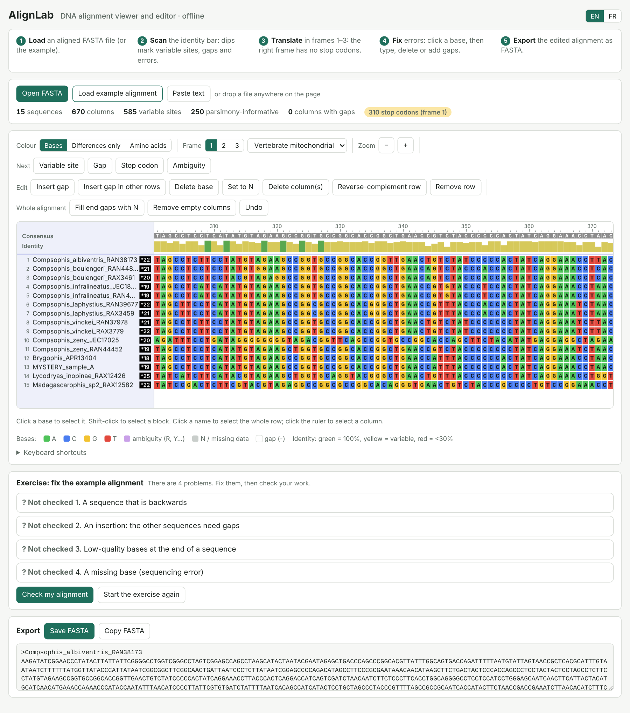
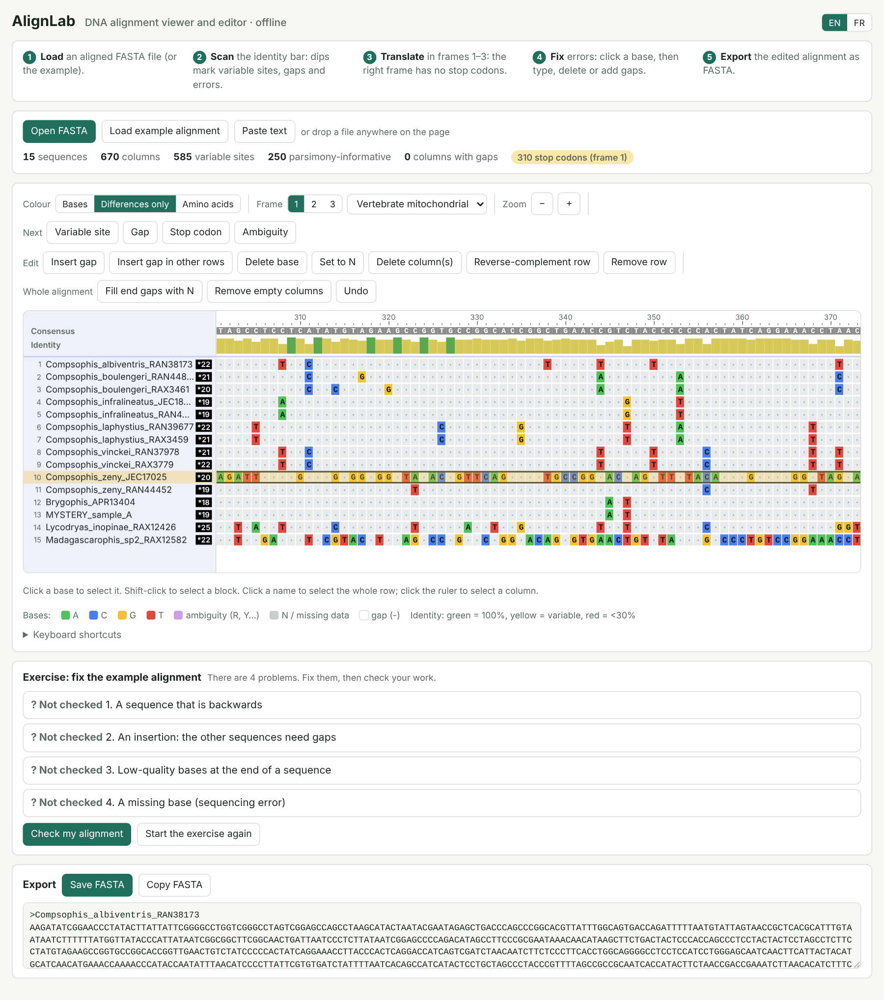
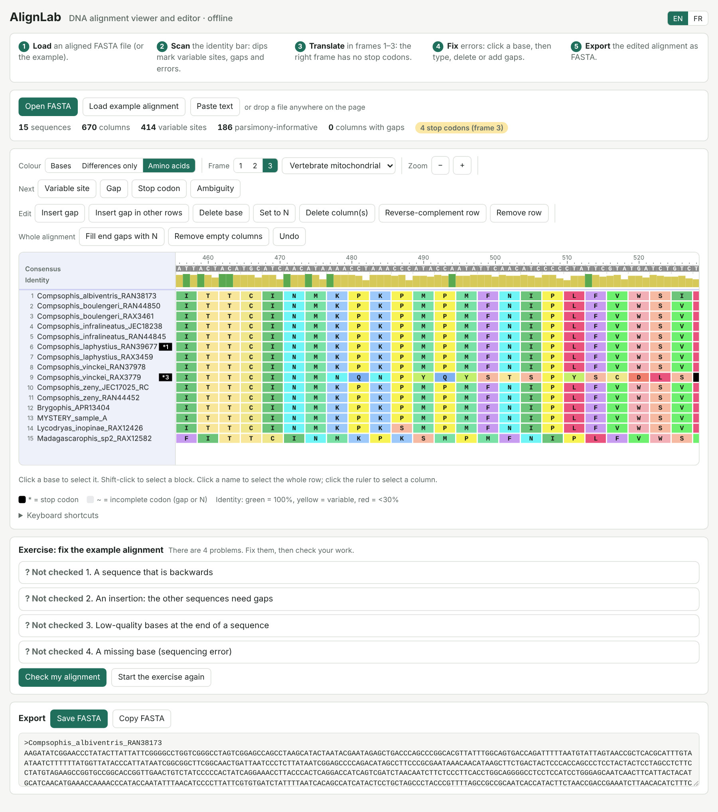

# DNA Sequence Alignment

 In this module you will align your mystery sequence with the similar sequences you downloaded in Module 2. Then you will learn to read an alignment, spot the difference between **real** insertions and deletions and **sequencing errors**, and fix problems before you estimate a tree.

You will use two browser tools: the **MAFFT** web server to make the alignment, and **AlignLab** to visualize and edit.
### Learning objectives

By the end of this module you should be able to:

1. Identify conserved, variable and parsimony-informative sites, gaps (indels) and ambiguity codes.
2. Use the reading frame to tell a real indel from a sequencing error in a protein-coding gene such as COI.
3. Fix common errors: reversed sequences, extra or missing bases, and low-quality ends.

## What data are we using?

| File | What it is | Use it for |
|---|---|---|
| Your `GroupA_COI_unaligned.fasta` (or Group B) | Your contig plus the BLAST/BOLD hits you downloaded in Module 2 | Exercise 1 and Exercise 3 |
| [example-alignment-Compsophis.fasta](data/example-alignment-Compsophis.fasta) | 15 COI sequences: 11 *Compsophis*, one *Brygophis*, a mystery sample and two outgroups.  | Exercise 2 |
| [AlignLab](AlignLab.html) | Alignment viewer and editor that runs in your browser, offline | Exercises 2 and 3 |

## What is an alignment?

When we align sequences, we slide them against each other and add **gaps** (`-`) so that bases that come from the **same position in a common ancestor** sit in the same **column**. Bases in the same column are called **homologous**.

```
Sample_1   ATGGCACTATTCGGAGCATGA
Sample_2   ATGGCACTGTTCGGAGCATGA     <- one difference (column 9)
Sample_3   ATGGCA---TTCGGAGCATGA     <- three bases missing: a deletion (or an insertion in the others)
```

### Words you will need

| Term | Meaning |
|---|---|
| **Conserved site** | A column where every sequence has the same base |
| **Variable (polymorphic) site** | A column with two or more different bases |
| **Parsimony-informative site** | A variable site where at least two different bases each appear in at least two sequences. These sites carry information about how sequences group together. |
| **Indel** | An **in**sertion or **del**etion. In an alignment it appears as a gap (`-`). We usually cannot tell if one sequence gained bases or the others lost them, so we just call it an indel. |
| **Missing data** | `N` or `?`: we do not know the base (no data, or the read ended) |


### Indels in a protein-coding gene

COI codes for a protein. DNA is read in groups of three bases (**codons**), and each codon becomes one amino acid. This gives us a powerful check:

* A **real** indel in COI almost always removes or adds a **whole codon**: 3, 6 or 9 bases. COI indels are rare in vertebrates.
* A gap of **1 or 2 bases** in one sequence shifts the reading frame. Every codon after it changes, and **stop codons** appear. A protein like this would not work, so the gap is almost certainly a **sequencing or editing error**, not a real mutation.

### Sequences of different lengths: end gaps and N

Your sequences will not all start and end at the same place: some reads are longer than others. After alignment the short sequences have gaps at their ends. These **end gaps** are not real deletions. They are simply places where we have **no data**.
To make this clear, fill end gaps with `N` (missing data), so that every sequence has the same length:

```
Before   ------ATGGCACTATTCGGAGCA---
After    NNNNNNATGGCACTATTCGGAGCANNN
```

Many tree programs, including RAxML, treat `-` and `N` the same way (as missing data). It is a good reminder that dahses are for insertions and Ns are for missing data.

## Errors that look like indels (but are not)

| What you see in the alignment | Likely cause | How to check | Fix |
|---|---|---|---|
| One sequence is different almost everywhere | It was not reverse-complemented (it is backwards) | Differences everywhere; many stop codons in every frame | Reverse-complement the sequence, then realign |
| A base in a column where **every other** sequence has a gap, often in a run like `CCCCCC` | Extra base called in a **homopolymer** (a run of the same base) | Look at the chromatogram at that spot | Delete the extra base (delete the column) |
| A single gap in one sequence | A base was missed (deleted) during sequencing or editing | Stop codons after the gap; check the chromatogram | Put the missing base back, or replace the gap with `N` |
| Many differences bunched at the very start or end of one sequence | Low-quality read ends that were not trimmed | Look at the chromatogram quality at that end | Replace those bases with `N` |
| A double-peak code (R, Y…) in a mitochondrial gene | Mixed signal: contamination, a nuclear copy of the gene (**NUMT**), or a noisy peak | Look at the chromatogram | Keep the code, or re-sequence |
| Stop codons in **every** sequence after one column | One sequence's error made the aligner add a gap column to all the others | Find the column where only one sequence has a base | Fix that one sequence; remove the now-empty column |

## Alignment programs

| Program | Free? | How you use it | Notes |
|---|---|---|---|
| [MAFFT](https://mafft.cbrc.jp/alignment/server/) | Yes | Web server or command line | Fast and accurate; can fix the direction of reversed sequences automatically. **Workshop choice.** |
| [MUSCLE](https://www.ebi.ac.uk/jdispatcher/msa/muscle) | Yes | EBI web server, command line, built into many programs | Fast, widely used |
| [Geneious Prime](https://www.geneious.com/) | No (free trial) | Desktop | Chromatograms, assembly, alignment and trees in one program |

## Exercise 1: Align your sequences with MAFFT

1. Open your `GroupA_COI_unaligned.fasta` (or Group B) from Module 2 in a text editor and copy everything.
2. Go to the [MAFFT online server](https://mafft.cbrc.jp/alignment/server/).
3. Paste your sequences into the input box.
4. Use these settings:

| Setting | Value | Why |
|---|---|---|
| Direction of nucleotide sequences | **Adjust direction according to the first sequence** (accurate) | MAFFT reverse-complements any backwards sequence for you and adds `_R_` to its name |
| Output order | **Same as input** | Your sequences stay in the order of your file, so you can find your mystery sample |
| Strategy | **Auto** | For a small dataset (fewer than ~200 sequences) MAFFT chooses a slow, accurate method (L-INS-i) |
| Everything else | Leave the defaults | Scoring matrix 200PAM, gap opening penalty 1.53 |

5. Click **Submit**. When the job finishes, open the result in **FASTA format** and save it as `GroupA_COI_aligned.fasta`.


*Figure 1: MAFFT settings for the workshop.*

> **Tip:** the first sequence sets the direction for all the others. Put a sequence you trust (for example a GenBank hit) first.

<details markdown="1">
<summary><b>What do the other MAFFT options do?</b> <i>(click to open)</i></summary>

| Option | Choices | When to change it |
|---|---|---|
| **Strategy** | **FFT-NS-1, FFT-NS-2** (fast), **FFT-NS-i** (iterative), **L-INS-i, G-INS-i, E-INS-i** (slow, accurate) | Fast methods are for hundreds or thousands of sequences. **L-INS-i** is best for a few hundred sequences or fewer. **G-INS-i** assumes the sequences are similar along their whole length. |
| **Output order** | Same as input / Aligned | "Aligned" groups similar sequences together. This looks nice, but makes your own sample harder to find. |
| **Output format** | Clustal / FASTA | Always save **FASTA** for AlignLab, RAxML and IQ-TREE. |


</details>

> <small>*If a file came from a BLAST or BOLD "aligned sequences" download, it already contains gaps from **pairwise** alignments. Remove them (Find `-`, Replace with nothing) before you paste the sequences into MAFFT.*</small>

> <small>***Not working internet? Your instructor also has an aligned backup file.*</small>

## Exercise 2: Find and fix errors in the example alignment

1. Open [AlignLab](AlignLab.html) and click **Load example alignment** (or open [example-alignment-Compsophis.fasta](data/example-alignment-Compsophis.fasta)).
2. Look at the top of the window:
   * **Consensus**: the most common base in each column.
   * **Identity**: tall green bars = all sequences agree; shorter yellow bars = variable sites; red = most sequences differ.
3. Note the number of **variable sites** and **stop codons** shown above the alignment. You will watch these numbers change as you fix errors.



*Figure 2: The example alignment in AlignLab, coloured by base.*

Work through the problems **in this order**. The order matters: an alignment with a backwards sequence in it gives misleading columns for everything else.

### 1. Find the backwards sequence

1. Click **Differences only**. Bases that match the consensus turn into grey dots, so only the differences stand out.
2. Scroll along the alignment. Which row is different almost everywhere?
3. Click its **name** to select the whole row, then click **Reverse-complement row**.
4. How many variable sites are there now?



*Figure 3: In "Differences only" mode, a backwards sequence stands out immediately.*

### 2. Find the correct reading frame

1. Click **Amino acids**. Each block of three columns becomes one amino acid. Stop codons are **black** (`*`).
2. Check that **Vertebrate mitochondrial** is selected as the genetic code. (In the standard code, `TGA` is a stop; in vertebrate mitochondria it codes for tryptophan, W.)
3. Click **Frame 1**, **2** and **3**. Which frame has the fewest stop codons?
4. In that frame, where do the stop codons start? Use **Next → Stop codon**.



*Figure 4: In the right frame, stop codons appear only after an error.*

### 3. Find the insertion

1. Stay in **Amino acids** view, frame 3, and scroll along. Find a row where, from one point on, every amino acid is **one position to the right** of the others, but there are **no stop codons**.
2. Switch to **Bases** or **Differences only**. At the very end of the alignment, which row sticks out 3 bases past all the others?
3. This sequence has **3 extra bases (one codon)** that the others do not have. Because 3 bases = 1 codon, the reading frame is not broken: this can be a **real insertion**. The other sequences need a gap of 3 here.
4. Click the first extra base, **Shift-click** the third, then click **Insert gap in other rows**.
5. How many variable sites are there now?

### 4. Find the missing base

1. In **Amino acids** view, frame 3, click **Next → Stop codon**. Which row has stop codons that no other row has?
2. Find where that row **stops matching** the others. From that column on, every base is shifted **one place to the left**: one base is missing.
3. A missing base (1 base, not 3) breaks the reading frame, so it is almost certainly a **sequencing error**. In real life you would check the chromatogram in TraceLab.
4. Click the first base that is out of place, click **Insert gap**. The rest of the row moves one place to the right and lines up again.
5. Click the new gap and click **Set to N**: we know a base is there, but not which one.

### 5. Find the low-quality end

1. Click **Differences only** and scroll to the very end of the alignment.
2. One sequence has a cluster of differences in its last bases that no other sequence shares. What is the most likely cause?
3. Select those bases (click the first, Shift-click the last) and click **Set to N**.

### 6. Check your work

1. Scroll down to **Exercise: fix the example alignment** and click **Check my alignment**.
2. Each problem shows **✓ Fixed** or **✗ Not yet**. The check updates after every edit.
3. Stuck? After you have checked once, a **Show answer** button appears next to each problem that is not fixed yet. Try on your own first!
4. When all 4 are fixed, there should be **0 stop codons** in frame 3.

### 7. Fill end gaps and save

1. Click **Fill end gaps with N**.
2. Click **Save FASTA** (or **Copy FASTA** and paste into a text editor). Save as `example_alignment_edited.fasta`.

## Quiz: what would you do?

Choose A or B first (alone or with your partner), then click to check.

**1. You look at your alignment and notice that one sequence, which should be very closely related to the others, has mostly different bases. What should you do?**

* **A)** Check whether the sequence is backwards: look at its reverse complement, and open the original chromatogram to check the sequence quality.
* **B)** Delete the sequence from your alignment. It has too many errors to keep in the project.

<details markdown="1">
<summary><b>Answer</b> <i>(click to check)</i></summary>

**A.** *A sequence that differs almost everywhere is very often just **backwards** (it was not reverse-complemented). Reverse-complement it first: if it suddenly matches the others, the problem is solved. If it still looks wrong, check the chromatogram. *

</details>

**3. One sequence has 3 extra bases that no other sequence has. There are no stop codons. What should you do?**

* **A)** Keep the 3 bases and add a gap of 3 to the other sequences. Check the chromatogram to make sure the bases are real.
* **B)** Delete the 3 bases. Anything that is only in one sequence must be an error.

<details markdown="1">
<summary><b>Answer</b> <i>(click to check)</i></summary>

**A.** *3 bases = one codon, so the reading frame is correct. This can be a **real insertion**. If the chromatogram is clean, keep the bases and give the other sequences a gap. *

</details>

## Exercise 3: Check your own alignment

Open your `GroupA_COI_aligned.fasta` from Exercise 1 in AlignLab and repeat the checks from Exercise 2:

3. Are there any single-base gaps or extra bases? Check them against your chromatogram in TraceLab.
4. Save as `GroupA_COI_aligned_edited.fasta`. This is the input for **Module 4: Estimating phylogenetic trees**.

## Discussion Questions


1.) Which reading frame was correct for the example alignment? How did you decide?

2.) Why did one **missing** base cause stop codons, but three **extra** bases did not?


### Record your analysis

> For Publication: *Sequences were aligned with MAFFT v[version] (online server, Auto strategy, direction adjusted to the first sequence; accessed [date]). The alignment was checked by eye in AlignLab. Sequencing errors were corrected against chromatograms, and terminal gaps were coded as missing data (N). The final alignment contained [number] sequences and [number] bp, with [number] variable and [number] parsimony-informative sites. Translation with the vertebrate mitochondrial code showed no stop codons.


## References

* <sub>Katoh, K., & Standley, D. M. (2013). MAFFT multiple sequence alignment software version 7: improvements in performance and usability. [Molecular Biology and Evolution, 30(4), 772–780](https://doi.org/10.1093/molbev/mst010).</sub>
* <sub>Edgar, R. C. (2004). MUSCLE: multiple sequence alignment with high accuracy and high throughput. [Nucleic Acids Research, 32(5), 1792–1797](https://doi.org/10.1093/nar/gkh340).</sub>

### Continue the workshop

* Previous: [Module 2: BLAST and BOLD searches](Module2-BLAST-searching.md)
* Next: [Module 4: Estimating phylogenetic trees](Module4-estimating-phylogenetic-trees.md)
* [Madagascar 2026 workshop home](https://fieldtophylogeny.github.io/Madagascar2026/)


### Continue the workshop

* Next: [Module 4: Estimating Phylogenetic Trees](Module4-estimating-phylogenetic-trees.md)
* [Madagascar 2026 workshop home](https://fieldtophylogeny.github.io/Madagascar2026/)

