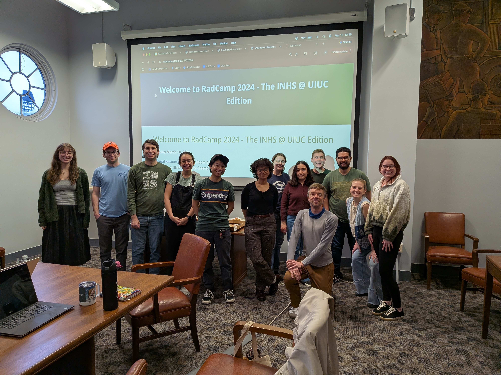

# Welcome to Field-to-Phylogeny 2026 - The Madagascar Edition

November 11-12, 2026   
Antananarivo, Madagascar 
**Day 1:** [Mahaliana](https://www.mahaliana.org/) 
**Day 2:** [Association Vahatra](https://www.vahatra.mg/en/) 

## Overview
This two-day workshop will provide participants with hands-on training in 
molecular and phylogenetic techniques commonly used in biodiversity research. 
Participants will work through the complete process of generating and analyzing 
DNA barcode data, beginning with tissue samples collected in Madagascar and 
ending with phylogenetic interpretation of sequence data. The workshop combines 
lectures, laboratory exercises, and computer-based analyses to provide a 
comprehensive introduction to molecular workflows used in species identification 
and evolutionary studies.

## Learning Objectives
By the end of this workshop, participants will be able to:

1. Understand the role of DNA barcoding and evolution in biodiversity research and conservation
2. Become familiar with following protocols to extract and quantifying DNA from field-collected tissue samples
3. Import and edit raw sequence data to generate consensus sequences from forward and reverse reads
4. Use online databases (such as BLAST) to confirm species identity and obtain comparative sequence data to build and edit alignments
5. Estimate and interpret phylogenetic trees
6. Interpret phylogenetic results (e.g., sequence uniqueness) to address meaningful evolutionary hypotheses

## Organisers, Instructors, and Facilitators

  - [Dr. Arianna Kuhn](https://directory.illinois.edu/detail?userId=alkuhn@illinois.edu&widgetId=15) (Illinois Natural History Survey; instructor/organizer)
  - [Dr. Sara Ruane](https://www.fieldmuseum.org/about/staff/profile/sara-ruane) (Field Museum; instructor/organizer)
  - [Fandresena Rakotoarimalala](https://orcid.org/0000-0003-3795-5954) (University of Antananarivo; instructor/organizer)
  - [Dr. Santatra Randrianarisoa](https://santatra.owlstown.net/) (Mahaliana; instructor)
  - [Dr. Voahangy Soarimalala](https://provost.ncsu.edu/global-one-health-academy/people/voahangy-soarimalala/) (Association Vahatra; collaborator)
  - [Dr. Fidisoa Rasambainarivo](https://biology.ecu.edu/faculty/fidisoa-rasambainarivo/) (East Carolina University; collaborator)
  - [Dr. Isaac Overcast](https://isaacovercast.github.io/) (University of Maine; INHS; collaborator)

### Instructor and partricipant introduction slides

[Brief introductions for the instructors and participants](https://docs.google.com/presentation/d/1RBkyEjekzo9iSPmykFqkeRvw5_-QtKkCoJFK7NFnG1c) (1-2 min. each)

## Registration

Registration for this edition of Field-to-Phylogeny is now closed. For information about future offerings, contact Arianna Kuhn (alkuhn@illinois.edu)

## Schedule Outline (View the [detailed schedule](https://docs.google.com/spreadsheets/d/113yLp8xCCP2BzPe6VioBBe7qrpIqij_uJ8uj1u2RQao))

Times       | Day 1 (Wed Nov 11); Mahaliana | Day 2 (Thu Nov 12); Vahatra |
-----       | ----- | ----- |
8:30-9:00   | Check-in & Intro to Pipetting | Check-in and computer setup |
9:00-12:00  | [DNA Extraction Part I](DNA-extraction.md) & Molecular Lab Lecture | [DNA Barcoding](Intro-Barcoding.md), [Sequence Editing Lab](Module1-sequence-editing-lab.md), [BLAST Searches](Module2-BLAST-searching.md), [Sequence Alignment Lab](Module3-sequence-alignment)|
12:00-13:30 | Lunch | Lunch |
13:30-17:00 | [DNA Extraction Part II](DNA-extraction.md) & DNA Quantification Lab | [Phylogenetic Inference w/ RAxML](Module4-estimating-phylogenetic-trees.md) & [Phylogenetics Visualization Lab](Module5-interpreting-phylogenetic-trees.md) |

## Workshop sponsored by:

    

  
  
Special thanks to generous funding from the [European Society for Evolutionary Biology](https://eseb.org/) for
supporting this workshop through the **Global Evolutionary Biology Initiative program**.

## Exit Survey

Don't forget to fill this out at the end of the workshop!  
[Field to Phylogeny 2026 Exit Survey](https://forms.gle/R9cGQnnbPN2m3jgY7)

## Group Photo

Really don't forget to take a few group photos!
<!--  -->

## Acknowledgements
A huge thank you to the [CCGL Lab](https://conservation-genetics.inhs.illinois.edu/) for supply assembly assistance!
