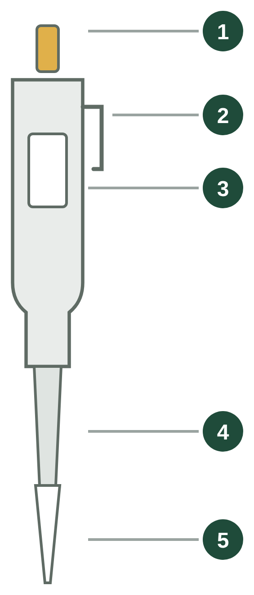
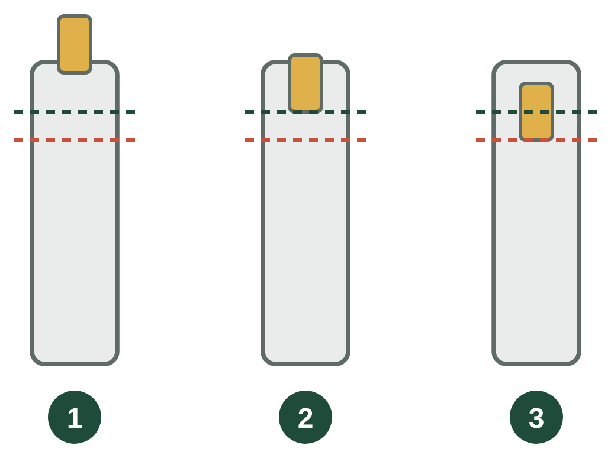
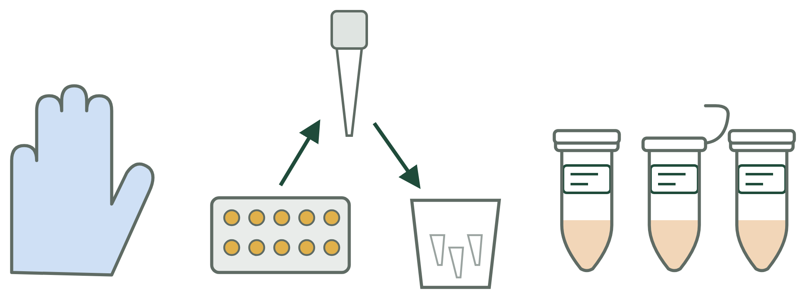

---
# Molecular Lab Basics

Today you will extract DNA from reptile and amphibian tissue. Almost every step uses a **micropipette** (*micropipette*). First, you will practice with a micropipette. Every person in your group should try parts of the exercise

**Goals:**

1. Choose the correct pipette and tip, and use the first and second stops.
2. Contamination is the biggest risk to our samples, follow tips to prevent this during the extraction!

## Part 1: Using a micropipette

### 1. Parts of a micropipette

| | Part | Partie | What it does |
|---|---|---|---|
| 1 | Plunger button | Piston | Press to take up and release liquid |
| 2 | Tip ejector | Éjecteur | Removes the used tip |
| 3 | Volume display | Affichage du volume | Shows the volume |
| 4 | Tip | Cône | The only part that touches the liquid. Use a **new tip** every time. |

### 2. Learning plunger stops

| Stop | How it feels | Use it to |
|---|---|---|
| **First stop** (*premier cran*) | You feel resistance | **Take up** liquid. Release most of the liquid. |
| **Second stop** (*deuxième cran*) | Press harder | Release the **last drop** only. **Never** to take up liquid. |

### 3. Choose the correct size pipette

Use the **smallest pipette** for your volume. It is more accurate (*précis*).

| Pipette | Volume | Tip colour | Today we use it for |
|---|---|---|---|
| P10 | 0.5–10 µL | clear | DNA for the Qubit (5 µL) |
| P200 | 20–200 µL | yellow | Proteinase K (20 µL), Buffer ATL (180 µL), AL (200 µL), ethanol (200 µL), AE (100 µL) |
| P1000 | 100–1000 µL | blue | Transfer to the column (~600 µL), AW1 and AW2 (500 µL) |

> **Never** turn the volume past the top or bottom of the range.

### Take up and release liquid

1. Put a **new tip** on the pipette. Press firmly.
2. Hold the pipette **vertical**. Press to the **first stop** and hold.
3. Put the tip **2–3 mm** into the liquid.
4. Release the plunger **slowly**. Wait 1 second. Take the tip out.
5. Touch the tip to the inside wall of the tube. Press slowly to the **first stop**, then to the **second stop**.
6. Keep the plunger pressed. Take the tip out of the tube. Then release the plunger.
7. Press the **tip ejector**. The tip goes in the waste.

<b>More tips</b> <i>(click to open)</i>

* **Never** lay the pipette down with liquid in the tip. The liquid goes into the pipette.
* Release the plunger **slowly**. If it is fast, you get air bubbles.
* Ethanol drips from the tip. Take up and release it once first (*pré-humidifier*), then take up your volume.
* Buffer AL makes foam (*mousse*). Pipette it slowly.

### Practice

Use the water on your bench.

| Volume | Pipette | Into | Check |
|---|---|---|---|
| 900 µL | P1000 | An empty 1.5 mL tube | It reaches the 0.9 mark |
| 20 µL | P200 | A drop on parafilm | Same size as the instructor's drop |
| 5 µL | P10 | A drop on parafilm | Smaller than the 20 µL drop |

✓ **Checkpoint:** every person in your group has done all three volumes.

### Quiz

Answer first, then click.

<b>1. You need 180 µL of Buffer ATL. Which pipette?</b>

**P200.** Use the smallest pipette for the volume. A P1000 is less accurate for 180 µL.

<b>2. Which stop do you use to take up liquid?</b>

**The first stop.** From the second stop, you take up too much.

<b>3. Why do you never lay a pipette down with liquid in the tip?</b>

The liquid goes **into the pipette**. This contaminates the pipette and your next samples.

## Part 2: Working clean

DNA is invisible. A very small amount of DNA from another sample can go into your tube. This is the most common error in DNA work.

* Wear **gloves**. They keep **your** DNA out of the samples.
* Use a **new tip for every tube and every reagent**. Never put a used tip in a reagent bottle.
* Label the **lid** and the **side** of every tube before you start. Side label: catalogue number / species / tissue. Example: `UADBA 43227` / *Nesomys lambertoni* / `liver in EtOH`.
* Liquid waste goes in the **waste beaker**, not in the sink.

### Continue the workshop

* Next: [DNA Extraction](DNA-extraction.md)
* [Madagascar 2026 workshop home](https://fieldtophylogeny.github.io/Madagascar2026/)

