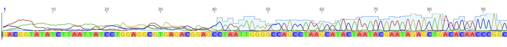
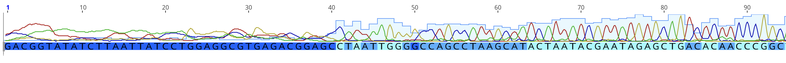

# Sequence editing
## Raw data files  
After Sanger sequencing, files are usually returned in raw format with the extension ".ab1". This raw format can be visualized as a chromatogram. This allows a quality control check to identify the quality of the sequence results, individual base calls, and the certainty of each base call. 

Here is a Chromatogram (visual trace plot) visualized in [Geneious Prime](https://www.geneious.com/features/prime#sequence-analysis) (Proprietary software, but free trial versions available). This shows fluorescent signal intensity (peak height) and base calls (codon letters; A, T, G, & C):

Base quality is tracked for each nucleotide position (here, this is viewed by shade of blue as well as by light blue quality bars):

Often, two raw files are produced per individual: the forward sequence, and the reverse sequence. These two sequences can be put together as a singe contiguous sequence (a "contig"), where both sequences overlap to account for low quality bases at the ends of the sequence. Let's download our raw .ab1 files Here:  

Group A:  
[Mystery-Sequence-A-Forward.ab1]  
[Mystery-Sequence-A-Reverse.ab1]   

Group B:  
[Mystery-Sequence-B-Forward.ab1]  
[Mystery-Sequence-B-Reverse.ab1]   
